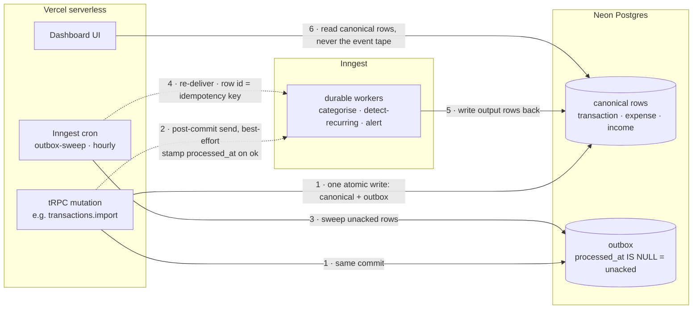

# Persist household finance state in canonical Postgres rows with a transactional outbox for at-least-once Inngest delivery, not an event-sourced log

## Context and Problem Statement

Today every write in this app is synchronous and self-contained: a tRPC mutation writes one row to `transaction`, `expense` or `income` and returns. Nothing fans out. That holds only while the app is a manual ledger.

The work this project is heading toward is not manual. Importing a bank statement produces hundreds of rows that then need follow-up work: auto-categorise each one against the vocabulary in `src/lib/constants.ts`; detect recurring charges and reclassify them as subscriptions (`docs/priorities.json` already records hand-found examples — *"identical $123.06 x5 - treat as subscription"*); flag duplicate charges (*"two identical $344.50"*); flag foreign-transaction fees; and raise a threshold alert when a `Must Have` category drifts. That work is slow, some of it is LLM-shaped, and none of it belongs on the import request.

So a write stops being just a row change. The fragile seam is the gap between **"the canonical rows committed"** and **"the follow-up work was durably scheduled."** Inngest is durable once it has accepted an event; the unprotected window is our own publish path. A process crash or a network blip between `COMMIT` and `inngest.send()` loses the side effect with no record that it was ever meant to fire — and after a statement import, "silently uncategorised" is indistinguishable from "correctly categorised as Uncategorised".

The runtime constrains the answer: this deploys to Vercel serverless (better-auth already trusts `*.vercel.run` / `*.v0.build`), so a long-running listener process is not available without new infrastructure.

How does this app persist household finance state and guarantee its side effects fire at least once — and which store is canonical?

## Decision Drivers

- **No COMMIT-then-fail gap.** The publish record must live in the same transaction as the canonical write. This is the failure mode the whole decision exists to close.
- **Canonical state must be directly queryable.** The dashboard runs aggregate SQL — `transaction.summary` alone issues five aggregates — over an amount-and-date shape. Folding a log on every read to answer "what did we spend on Utilities in July" is the wrong shape for this data.
- **At-least-once delivery with operator-visible recovery.** A categorisation pass that should run must eventually run, and a stuck publish must be visible somewhere it can be found.
- **The UI reads canonical rows, never the event tape.** Screens stay simple SQL reads regardless of what asynchronous machinery lands behind them.
- **Serverless-friendly.** No long-running listener; scheduled work must fit Inngest crons on Vercel.
- **A single fan-out seam.** Adding a new follow-up behaviour should be a new worker on an existing event, not an edit at every write site.

## Considered Options

1. Canonical Postgres rows + transactional outbox + durable worker (Inngest)
2. Event-sourced `finance_events` log as the source of truth
3. Direct `inngest.send` from the mutation, no outbox
4. `inngest.send` inside the DB transaction, throw on failure

## Decision Outcome

Chosen option: "1. Canonical Postgres rows + transactional outbox + durable worker (Inngest)", because it is the only option that binds the publish record to the same transaction as the canonical write while keeping Inngest's availability off the request path, keeping the dashboard's aggregate reads on plain indexed rows, and fitting Vercel's serverless runtime without a long-running listener.

The posture, stated once — the clauses that bind:

1. **Canonical store.** Neon Postgres rows own all durable domain state — `transaction`, `expense`, `income` and every table after them. Derived values (a category assigned by a worker, a `Recurring` frequency flag, a detected subscription link) are written back onto those rows as output state, not accumulated in a log.
2. **Atomic write.** Every write with side effects commits its canonical rows and its outbox rows in **one** transaction boundary. The mechanism is specified in [adr003](adr003-neon-http-db-batch-for-atomic-outbox-writes.md).
3. **Delivery.** After the commit, the writer attempts `inngest.send()` for each new outbox row. On success it stamps `processed_at`; on failure it logs and **swallows** — the mutation's success contract is "the canonical rows were committed," not "every downstream worker was notified." An Inngest cron sweeps rows where `processed_at IS NULL` and re-delivers them. The sweep is the durable backstop, not the fast path.
4. **Sweep cadence: hourly, with a 30-second row-age floor.** The cron runs `0 * * * *`; its filter carries `created_at < now() - interval '30 seconds'` so it cannot race the post-commit send. Under any real load every event is delivered by the post-commit send and never reaches the sweep, so the hourly cadence trades worst-case backstop latency for letting Neon's compute scale to zero instead of being pinned open by per-minute polling.
5. **Idempotency.** The outbox row `id` **is** the Inngest idempotency key. A sweep racing the post-commit send is a guaranteed no-op. This is an infrastructure guarantee, not per-worker application logic.
6. **Control state vs output state.** Inngest owns live run state (an in-flight categorisation pass over an import batch). The DB owns the canonical output rows the dashboard reads. **The UI never reads the event tape.**
7. **Typed event surface.** A single Zod `EVENT_REGISTRY` in `src/server/inngest/events.ts` maps event name → payload schema and is the sole naming authority, deriving `EventName`, `EventPayload<K>` and `OutboxEventDescriptor`. `buildOutboxEvent(name, payload)` parses the payload against the registry and returns `{ id, name, data }`; the caller hands the write door (`commitWithOutbox`) a function deriving descriptors from the writes' result (so a payload can carry a DB-generated id), and the door inserts them in the same transaction as the canonical rows. The registry is the outbox delivery catalogue only; a direct `inngest.send` with no canonical row to attach to (a dev tracer ping, a manual reconcile trigger) is deliberately excluded.

This is explicitly **not** event sourcing: rows are canonical, and the outbox exists only for *delivery*. No surface may fold state out of the event history.

Initial event vocabulary — `transactions.batch-imported`, `transactions.categorisation-requested`, `transactions.categorised`, `subscriptions.detected`, `budget.threshold-breached`. One row per event, never one row per subscriber.



### Outbox table shape

```sql
CREATE TABLE outbox (
  id           uuid PRIMARY KEY NOT NULL,
  name         text NOT NULL,
  data         jsonb NOT NULL,
  created_at   timestamptz DEFAULT now() NOT NULL,
  processed_at timestamptz,
  attempts     integer DEFAULT 0 NOT NULL,
  last_error   text
);

-- partial index: the sweep only ever reads the unacked set. WHERE processed_at IS NULL
-- pins processed_at constant within the set, so created_at alone serves the age filter
-- and the ORDER BY — a leading processed_at would add a zero-selectivity column.
CREATE INDEX outbox_unprocessed_idx ON outbox (created_at)
  WHERE processed_at IS NULL;
```

`id` is generated by the writer with `crypto.randomUUID()` before the write, not by the database — [adr003](adr003-neon-http-db-batch-for-atomic-outbox-writes.md) explains why ids must be pre-resolved.

A companion `outbox-prune` cron (`0 3 * * *`) deletes rows with `processed_at < now() - interval '7 days'`. Stuck rows (`processed_at IS NULL AND attempts > N`) are never auto-pruned — they stay visible until cleared deliberately.

### Implementation status

The decision outruns the code, deliberately and visibly:

- **Present today:** Postgres via Drizzle, tRPC v11, the canonical `transaction` / `expense` / `income` tables.
- **Not yet present:** Inngest is not a dependency, there is no `outbox` table, no `src/server/inngest/`, no `src/server/outbox/`, and no import pipeline to trigger any of it. The database is a Neon Postgres branch over `postgres-js` — `scripts/neon-branch.sh` gives each non-`main` git branch its own `local/<branch>` branch, and `main` targets production; the `postgres-js` → `neon-http` swap in [adr003](adr003-neon-http-db-batch-for-atomic-outbox-writes.md) is still pending.

This is recorded as **Accepted** rather than Proposed because `.claude/rules/server-architecture.md` and `.claude/rules/database-migrations.md` already bind new code to this contract. Recording it as Proposed would leave the rules citing a decision the project had not made.

### Positive Consequences

- **No COMMIT-then-fail loss.** The intent to publish is committed with the data. Recovery is possible because the record of what was meant to fire survives the failure.
- **Import stays fast and Inngest stays off the request path.** An Inngest outage degrades follow-up latency, not the user's ability to import a statement or add a transaction.
- **A new follow-up behaviour is a new worker.** Duplicate-charge detection and FX-fee flagging attach to `transactions.batch-imported` with no change at any write site.
- **The dashboard keeps plain SQL reads.** `transaction.summary`'s aggregates run against indexed rows and are unaffected by everything above.
- **Event payloads are checked at both compile time and run time.** Clause 7 turns event-name typos and payload drift into type errors plus Zod parse failures at the emit site.

### Negative Consequences

- **Worker idempotency is non-negotiable.** Every consumer keys on the outbox row id. A double fire would double-categorise a batch, write a duplicate subscription record, or send two threshold alerts. The infrastructure key makes the retry safe; per-worker application logic would be far more error-prone.
- **The post-commit send fails silently by contract.** Propagating an `inngest.send` error to the user is a code-review-blocking pattern. The cost is that a delivery failure is invisible in the UI and visible only in logs until the sweep clears it.
- **Worst-case backstop latency is ~1 hour.** Accepted per clause 4: real traffic never touches the sweep. If a future side effect needs a tighter floor, the cadence is a tuning knob, not a contract.
- **The outbox becomes the canonical surface for every write-with-side-effect.** New write sites — an import endpoint, admin tooling, a future bank-feed webhook — must insert outbox rows in the same transaction. Enforcement is code review until the `commit(writes, outboxEvents)` primitive in [adr004](adr004-domain-oriented-3-tier-server-architecture.md) makes it structural.
- **Outbox lifecycle is standing operational overhead.** Prune policy, growth monitoring and stuck-row visibility are ongoing, for a single-household app whose event volume is measured in hundreds per import.
- **Lock-in to Inngest as the durable worker is real and accepted.** Mitigated because every transition emits a replayable event; the outbox itself is vendor-neutral Postgres.
- **This is real machinery for a pre-PMF single-household prototype.** The honest cost: an outbox table, two crons, an event registry and a worker tier, none of which the current manual-entry app needs. Accepted because the import-and-enrich pipeline is the project's next step and retrofitting atomicity onto write sites after they exist is materially harder than starting with it.

## Pros and Cons of the Options

### 1. Canonical rows + transactional outbox + durable worker

The outbox row is written inside the canonical transaction; the post-commit `inngest.send` is the best-effort fast path; the cron sweep is the durable backstop. The row id doubles as the idempotency key.

| Pros                                                                                                        | Cons                                                                                                     |
| ------------------------------------------------------------------------------------------------------------ | ---------------------------------------------------------------------------------------------------------- |
| Publish record shares the canonical write's transaction — the COMMIT-then-fail gap is closed                | Two delivery paths, so every worker must be duplicate-safe via the row-id idempotency key                |
| Inngest availability is off the request path — an outage degrades follow-up latency, not data capture       | Every new write site must remember the outbox until `commit()` makes it structural                       |
| The sweep is one indexed SQL query on an Inngest cron — no long-running listener                            | Outbox needs a prune policy and growth monitoring                                                        |
| A new subscriber is a new worker on an existing event — one fan-out seam                                    | Worst-case backstop latency ~1 h; rules the pattern out for sub-second propagation                       |
| Dashboard aggregates keep reading plain indexed rows                                                        | Non-trivial infrastructure for a prototype's current write volume                                        |

### 2. Event-sourced `finance_events` log as the source of truth

Every change is an immutable event; current balances and category totals are folded from the log, with read models projected for the dashboard.

- Bad, because the dashboard's five aggregate queries become projections that must be rebuilt and kept consistent — real machinery to answer questions that are one `GROUP BY` against rows today.
- Bad, because the natural queries here are inherently row-and-range shaped ("all transactions in this date window, grouped by category"), which is what the existing `transaction_date_idx` and `transaction_priority_idx` already serve.
- Bad, because corrections are routine in this domain — recategorising a merchant, fixing an import mistake — and each becomes a compensating event rather than an `UPDATE`, for no audit requirement this project has.
- Good, because a full history of recategorisations would be genuinely interesting. That is a `transaction_history` child table if it is ever wanted, not a change of source of truth.

### 3. Direct `inngest.send` from the mutation, no outbox

The mutation commits the canonical rows and then calls `inngest.send()` in the same handler. No outbox table, no sweep.

- Bad, because a failure after `COMMIT` silently loses the side effect and leaves no record that anything was meant to fire — unrecoverable by construction.
- Bad, because after a statement import the failure is invisible: uncategorised rows look exactly like rows correctly categorised as `Uncategorised`.
- Bad, because there is no operator surface at all — nothing to sweep, nothing to alert on, nothing to replay.

### 4. `inngest.send` inside the DB transaction, throw on failure

The send happens inside the canonical transaction; a send failure rolls the write back and surfaces to the user.

| Pros                                                                            | Cons                                                                                                            |
| --------------------------------------------------------------------------------- | ----------------------------------------------------------------------------------------------------------------- |
| All-or-nothing semantics — either both the write and the publish happen, or neither | Inngest's availability joins the request path; an Inngest outage fails every transaction write and every import |
| No outbox table, no sweep, no idempotency-key contract                          | A network call inside a transaction holds locks for its duration — the classic long-transaction contention bug  |
|                                                                                 | Not available anyway under [adr003](adr003-neon-http-db-batch-for-atomic-outbox-writes.md): the batch form takes statements, not arbitrary async work |

## Links

- Atomicity mechanism: [adr003](adr003-neon-http-db-batch-for-atomic-outbox-writes.md) — how clause 2's "one transaction" is actually achieved
- Enforced by: [adr004](adr004-domain-oriented-3-tier-server-architecture.md) — the repository `commit(writes, outboxEvents)` primitive makes the outbox structurally unavoidable at every write site
- Table home: [adr005](adr005-per-domain-drizzle-schema-files.md) — the `outbox` table lands module-vertical at `src/server/outbox/outbox.schema.ts`
- Reaffirmed: [2026-08-16 expense-linking/receipts/cashflow design](../../thoughts/designs/2026-08-16-expense-linking-receipts-cashflow.md) — first real implementation (receipt pipeline); re-weighed against inline processing and Vercel Workflow in 2026-08 and the decision stands
- Observability: [adr015](adr015-posthog-over-opentelemetry-via-vercel-otel.md) (In Progress) — stuck-row and persistent-send-failure alerts land as PostHog Logs alerts on the `outbox-sweep` log records; [adr016](adr016-trace-context-in-outbox-payload.md) carries the producer's trace context in the outbox row's `data`
