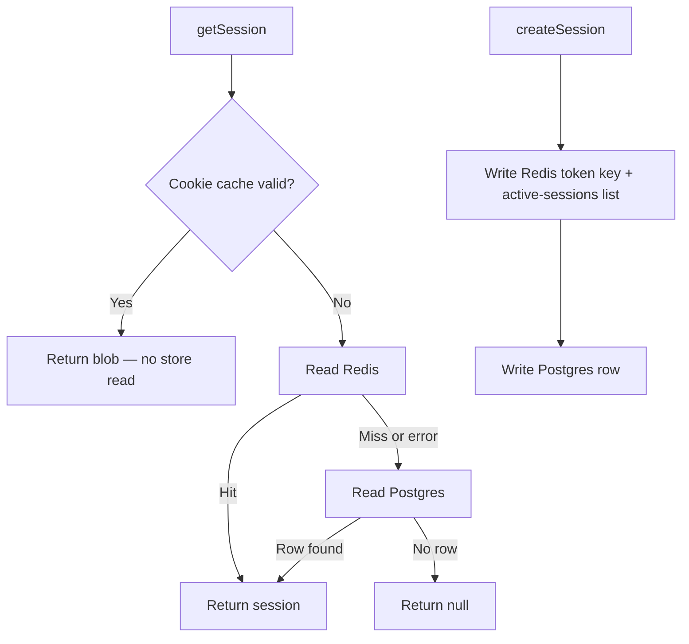

# Cache sessions in Upstash Redis with Postgres retained as the durable copy

Design: [2026-08-11 Better Auth secondary storage on Upstash Redis](../../thoughts/designs/2026-08-11-better-auth-upstash-secondary-storage.md)

## Context and Problem Statement

Better Auth 1.6.26 enables rate limiting in production by default, but `rateLimit.storage` defaults to `"memory"` unless a `secondaryStorage` is configured (`node_modules/better-auth/dist/context/create-context.mjs:171-174`). On Vercel that counter lives inside one lambda instance and dies on cold start, so an attacker moving between instances is never counted. Rate limiting is configured, appears active, and does not work. This is the concrete defect.

Session reads are the second force. `createTRPCContext` (`src/server/api/trpc.ts:29-31`) resolves a session on every tRPC request, and `getSession` (`src/server/better-auth/server.ts:5`) is called from `(dashboard)/layout.tsx`, `sign-in/page.tsx` and `sign-up/page.tsx`. React `cache()` dedupes those within a render, so today's cost is roughly one database read per render plus one per tRPC request. `src/server/db/index.ts:1-2` still runs `drizzle-orm/postgres-js` over a pooled connection, so these are not the per-call HTTP round trips that [adr003](adr003-neon-http-db-batch-for-atomic-outbox-writes.md)'s deferred `neon-http` swap would introduce — that pressure arrives only if the driver migration ever lands.

An Upstash Redis instance already exists, provisioned through Vercel, exposing `KV_REST_API_URL` and `KV_REST_API_TOKEN`. Configuring it as Better Auth's `secondaryStorage` moves sessions, the per-user session list, and verification records out of Postgres, and switches rate limit storage to Redis as a side effect of the default above.

The catch is that moving sessions changes what happens when Redis is unavailable. `internal-adapter.mjs:243-246` gates the Postgres fallback on two flags, and only one combination preserves it:

```js
const sessionStringified = await secondaryStorage.get(token);
if (!sessionStringified && (!options.session?.storeSessionInDatabase || ctx.options.session?.preserveSessionInDatabase)) return null;
```

Where should session state live, and what must remain in Postgres so that a Redis failure degrades performance rather than signing every user out?

## Decision Drivers

- **Rate limiting must survive instance churn.** The counter has to be shared across lambda instances, or the defect is unfixed.
- **A Redis failure must not sign users out.** Upstash is a new dependency; adopting it must not make authentication strictly less reliable than it is today.
- **A revoked session must not survive revocation.** Whatever caching exists cannot outlive an explicit sign-out.
- **Complexity must be earned.** Status is pre-PMF prototype with one developer and no load data. Machinery that only pays off at scale is a cost, not an investment.
- **Protect the Neon connection budget.** Anticipatory rather than measured, but [adr003](adr003-neon-http-db-batch-for-atomic-outbox-writes.md)'s deferred `neon-http` swap targets exactly this — keeping per-request database work down.

## Considered Options

1. **Redis only** — `storeSessionInDatabase: false`. Sessions exist solely in Redis.
2. **Dual-write, Redis-first reads** — `storeSessionInDatabase: true`, `preserveSessionInDatabase: false`. Redis is a cache; Postgres is the durable copy.
3. **Dual-write, preserving database rows** — `storeSessionInDatabase: true`, `preserveSessionInDatabase: true`.
4. **No session secondary storage** — cookie cache for read volume, `rateLimit.customStorage` backed by Redis for the defect. Sessions stay entirely in Postgres.

## Decision Outcome

Chosen option: **"2. Dual-write, Redis-first reads"**, because it is the only configuration in which a Redis miss — whether from an outage, an eviction, or a first deploy — falls through to Postgres instead of returning `null` and signing the user out. See the diagram under option 2.

Two settings follow from it and are part of this decision:

- `verification: { storeInDatabase: true }`. Without it, `internal-adapter.mjs:593-600` skips the Postgres write for verification records and `:618` returns `null` rather than falling back, leaving single-use credentials Redis-only. No flow writes one today, but password reset would inherit the gap silently.
- `rateLimit.storage` tracks whether an adapter was actually built: `secondaryStorage ? "secondary-storage" : "memory"`. Naming `"secondary-storage"` unconditionally overrides Better Auth's own selection (`create-context.mjs:174`) and does **not** degrade to memory when none is wired — the backend reads through `ctx.options.secondaryStorage?.get`, which is always `undefined`, so `decideConsume(null, …)` returns `allowed: true` every time (`api/rate-limiter/index.mjs:25-35`). The limiter would be off, not degraded, in any runtime started with `SKIP_ENV_VALIDATION` and no KV credentials.
- The Redis key prefix is `ba:${VERCEL_ENV ?? "development"}:${dbFingerprint}:`, where `dbFingerprint` is a truncated SHA-256 of `DATABASE_URL`. Better Auth uses the raw session token as its key with no namespace, and `scripts/neon-branch.sh:130-139` gives every git branch its own database. Keying the namespace to the database makes it structurally impossible to read a cached session alongside a database that did not create it.

### Positive Consequences

- Rate limit counters are shared across lambda instances, which fixes the defect.
- Session reads are served from Redis, leaving Postgres untouched on the hot path.
- A Redis outage, eviction, or accidental flush degrades to Postgres reads. Nobody is signed out.
- Deploying signs nobody out. Existing sessions have no Redis key, miss, and fall through.
- Local worktrees and preview deployments cannot authenticate each other's sessions, because each has a distinct `DATABASE_URL` and therefore a distinct namespace.
- Rotating the Neon connection string orphans the namespace harmlessly — every read misses, falls through to Postgres, and the orphans expire on their own TTL.

### Negative Consequences

- `session` rows accumulate. Redis-first reads mean expired rows are never touched, and Better Auth only deletes a row when someone tries to use it. At current usage this is roughly 52 rows a year; a scheduled `DELETE FROM session WHERE expires_at < now()` is deferred until it matters, and does not require Inngest — `.github/workflows/post-deploy.yml:96-103` already runs SQL against the database on a workflow trigger.
- `preserveSessionInDatabase` is a live footgun. It reads as the safer setting and is the opposite: it keeps revoked rows, so Better Auth disables the Postgres fallback to stop revoked sessions resurrecting. It must stay at its `false` default.
- Two stores hold session state, so any future change to session shape has to consider both.
- Adds Upstash and `@upstash/redis` as production dependencies.
- Development, preview, and production share one Upstash database. Development traffic burns production quota and a stray `FLUSHALL` hits everything. The prefix prevents cross-environment authentication but not shared blast radius; a database per environment is the end state.
- The cookie cache accompanying this change (`maxAge: 60`) means a session revoked from another device stays usable for up to 60 seconds. Signing out on the current device clears the cookie immediately.
- Eviction is confirmed disabled on the Upstash instance, which is what this decision assumes: at capacity Redis rejects writes rather than dropping session keys silently. The cost of that choice lands in [adr007](adr007-asymmetric-failure-posture-in-the-redis-adapter.md) — rejected writes are swallowed, so exhaustion degrades quietly to Postgres-only rather than surfacing.

## Pros and Cons of the Options

### 1. Redis only

`storeSessionInDatabase: false`. The `session` table stops being written.

| Pros | Cons |
| ---- | ---- |
| Simplest write path — one store, no duplication | An Upstash outage signs out every user; `internal-adapter.mjs:245` returns `null` with no fallback |
| No `session` table growth, so no sweep is ever needed | An eviction or accidental flush is unrecoverable data loss, not a cache miss |
| Fastest reads | Makes authentication strictly less reliable than the status quo, violating a driver |

### 2. Dual-write, Redis-first reads

`storeSessionInDatabase: true`, `preserveSessionInDatabase: false`. Redis is a cache over Postgres.



| Pros | Cons |
| ---- | ---- |
| The only configuration that preserves the Postgres fallback | Two stores to keep in mind |
| Redis failure degrades performance, never availability | `session` rows accumulate unread |
| Rollout and rollback both sign nobody out | Depends on a non-obvious flag combination that reads as less safe than option 3 |
| Writes are rare — one per login plus one refresh per day from `updateAge` — so the duplication costs almost nothing | Requires a matching `verification.storeInDatabase` setting to avoid the same gap elsewhere |

### 3. Dual-write, preserving database rows

`storeSessionInDatabase: true`, `preserveSessionInDatabase: true`. Sounds like option 2 with an extra safety margin.

- Good, because the `session` table retains a full history of issued sessions.
- Bad, because it **disables the Postgres fallback**. `internal-adapter.mjs:245` treats a Redis miss as definitive, so this behaves like option 1 on failure while still paying option 2's write cost.
- Bad, because retained rows are exactly why the fallback is disabled — they include revoked sessions, which the fallback would resurrect.
- Bad, because it is the option most likely to be chosen by mistake, on the reasonable-sounding grounds that preserving more data is safer.

### 4. No session secondary storage

Cookie cache plus `rateLimit.customStorage` (`@better-auth/core/src/types/init-options.ts:209`, checked before the `secondaryStorage` path). Sessions never leave Postgres.

| Pros | Cons |
| ---- | ---- |
| Fixes the concrete defect — rate limiting — with no change to session storage | Store reads still hit Postgres once the 60s cookie cache lapses, per device |
| No dual-write, no fallback semantics, no key namespace, no `session` bloat | Does not serve [adr003](adr003-neon-http-db-batch-for-atomic-outbox-writes.md)'s `neon-http` driver if that (now deferred) migration ever lands |
| Roughly a third less design surface, and no ADR-worthy decisions | Requires hand-writing a `BetterAuthRateLimitStorage` including `consume`, rather than getting it from the `secondaryStorage` default |
| Zero risk to authentication correctness — the failure modes stay exactly as they are today | Leaves Redis in the stack serving a single narrow purpose |

This is the closest alternative and the one a future reader is most likely to propose. It was rejected because Redis is being adopted either way, the incremental infrastructure cost of also caching sessions is zero, and dual-write bounds the downside: if Redis proves useless, the runtime behaviour is option 4.

## Links

- Refined by [ADR007](adr007-asymmetric-failure-posture-in-the-redis-adapter.md) — the per-operation failure posture this cache depends on
- Constrains [ADR003](adr003-neon-http-db-batch-for-atomic-outbox-writes.md) — the connection budget this reduces pressure on
- Placement follows [ADR004](adr004-domain-oriented-3-tier-server-architecture.md) — `better-auth/` is collapsed infrastructure, so the adapter sits beside `config.ts`
