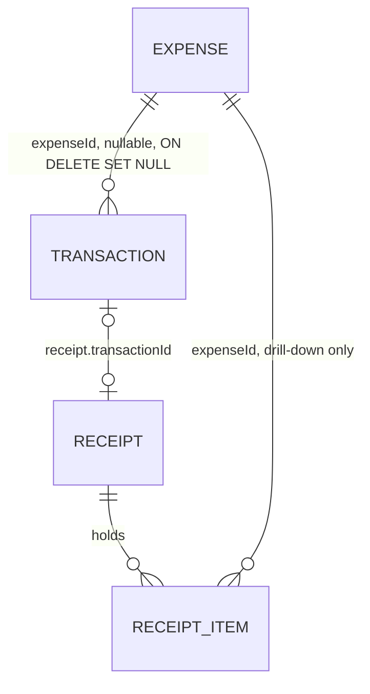
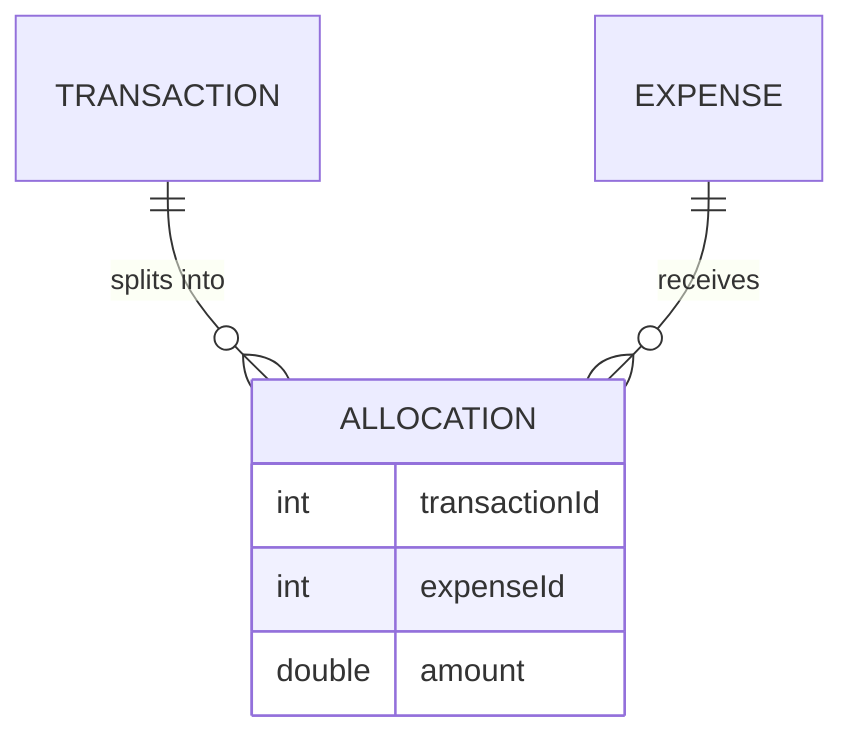

# Link Transactions to Expenses with a single nullable FK; per-item granularity arrives via Receipt line items, not a split table

Technical Story: [2026-08-16 expense-linking/receipts/cashflow design](../../thoughts/designs/2026-08-16-expense-linking-receipts-cashflow.md)

## Context and Problem Statement

The Must-have feature set links Transactions to Expenses: the Planned page shows an actual-vs-budget column per Expense, and **Unplanned** is a Spend Transaction with no plan behind it (see `CONTEXT.md`). A real household basket complicates the link's shape: one supermarket Transaction can cover groceries, homewares and a birthday present — three budgets on one docket. Personal-finance convention answers with an allocation (split) table, where a human divides each Transaction's amount across budgets.

The same design also schedules Receipt extraction (Should-have, stage 5): a Receipt already itemises the basket, and each `receipt_item` can carry its own Expense attribution — the split arrives pre-divided, as evidence, without anyone retyping amounts.

What is the canonical shape of the Transaction→Expense link?

## Decision Drivers

- **Unplanned must stay definitional-by-absence.** The Unplanned page is `amount > 0 AND expenseId IS NULL`. A link shape that turns "is this planned?" into a join through a second table taxes every such query and makes the definition maintainable state instead of a fact.
- **Actual-vs-budget is the highest-frequency read.** The Planned page actual column, over-budget highlight, one-time consumed/remaining, and the cash-flow chart's one-time remaining are all sums of linked Transactions per Expense.
- **Receipts already carry the split.** Line items are the automatable per-item granularity; a split editor is the manual version of what the Receipt pipeline automates.
- **Deletion must not orphan.** Deleting an Expense must return its Transactions to Unplanned with no cleanup pass.
- **Ceremony budget.** Pre-PMF, single household: a split-editor UI plus an allocations-sum-to-amount invariant is real work with no user ask behind it.

## Considered Options

1. Single nullable `transaction.expenseId` FK; per-item granularity from `receipt_item.expenseId`
2. Allocation table (`transactionId`, `expenseId`, `amount`) — the conventional split model

## Decision Outcome

Chosen option: "1. Single nullable FK", because it keeps "planned?" a one-column predicate and actual-vs-budget a single leftJoin, and the genuinely mixed basket is served by Receipt line items — evidence that arrives itemised — rather than by amounts a human retypes into a split editor (see the diagram under option 1).

Adopted mechanics, from the unexecuted [2026-08-11 plan](../../thoughts/plans/2026-08-11-transaction-expense-mapping.md), adopted as written: nullable `transaction.expenseId` int FK → `expense.id`, `ON DELETE SET NULL`, leftJoin reads (no `relations()`), Zod input in `transactions.dto.ts`, expense picker in the transaction form.

**Attribution rule (double-count guard):** the Transaction-level FK is the accounting link — every actual / consumed / remaining sum reads it alone. `receipt_item.expenseId` is explanatory drill-down ("*what* pushed Groceries over"), never a second input to the sums.

### Positive Consequences

- The Unplanned page needs no new table and no state; linking a row removes it from the view by definition, so the view can never drift from reality.
- `ON DELETE SET NULL` gives the deletion invariant for free: deleting an Expense returns its Transactions to Unplanned; nothing orphans.
- The one FK covers both Expense kinds ([adr011](adr011-one-time-budgets-as-expense-kind.md)), so one-time consumed/remaining reuses the identical machinery.
- Input surface stays one optional int through Zod/tRPC; the form gains a picker, not an editor.

### Negative Consequences

- A mixed basket is attributed whole to one Expense until its Receipt is itemised — actuals are coarse until stage 5 ships, and stay coarse for Transactions whose receipts are never captured.
- Two attribution surfaces exist long-term (transaction FK, receipt items). The "sums read the FK alone" rule is a convention queries must honour; nothing structural prevents a future query from double-counting.
- No partial linking: a Transaction is fully planned or fully Unplanned.

## Pros and Cons of the Options

### 1. Single nullable `transaction.expenseId` FK

| Pros                                                                        | Cons                                                                          |
| --------------------------------------------------------------------------- | ------------------------------------------------------------------------------ |
| "Planned?" is `expenseId IS NULL` — no join, no state, cannot drift         | Whole-Transaction granularity until the Receipt pipeline itemises the basket   |
| Actuals are one leftJoin sum, shared by Planned page, one-timers, cash flow | Double-count guard between FK and receipt items is convention, not schema      |
| `SET NULL` makes Expense deletion self-cleaning                             | Refunds and fee lines inherit the whole-row link                               |
| UI is a picker; zero split-editor surface                                   |                                                                                |

### 2. Allocation table

- Good, because per-budget amounts are exact from day one, receipts or not.
- Good, because partial refunds and fee lines are representable per budget.
- Bad, because "is this planned?" becomes an `EXISTS` against the split table — Unplanned stops being definable by a column's absence, and every planned/unplanned consumer pays the join.
- Bad, because it demands a split-editor UI plus an allocations-sum-to-amount invariant, for a household that never asked to split by hand.
- Bad, because once receipt items land, the table is a hand-maintained duplicate of data the Receipt already carries itemised.
- Bad, because Expense deletion needs cascade rules plus re-derivation of planned state — the SET-NULL-returns-to-Unplanned invariant is lost.

## Links

- Companion: [adr011](adr011-one-time-budgets-as-expense-kind.md) — the `kind` discriminator that lets this one FK cover one-time budgets too
- Adopts: [2026-08-11 transaction-expense mapping plan](../../thoughts/plans/2026-08-11-transaction-expense-mapping.md)
- Design: [2026-08-16 expense-linking/receipts/cashflow design](../../thoughts/designs/2026-08-16-expense-linking-receipts-cashflow.md)
- Table home per [adr005](adr005-per-domain-drizzle-schema-files.md): `src/server/transactions/transactions.schema.ts`
