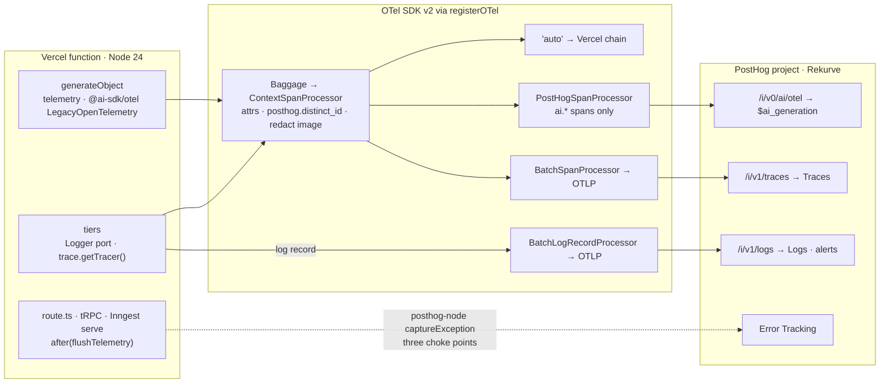

# Emit traces, logs, LLM analytics and errors to PostHog over OpenTelemetry via `@vercel/otel`, behind an injected `Logger` port and the ambient OTel API

Technical Story: [2026-09-15 PostHog observability design](../../thoughts/designs/2026-09-15-posthog-observability.md)

## Context and Problem Statement

The server's entire observability surface is 15 `console.*` calls across 10 files. When a receipt fails there is no way to see, in one place, the tRPC call or inbound email that created it, the outbox delivery, each Inngest attempt, the Bedrock prompt and response, tokens, cost and the error. Nothing alerts. [adr002](adr002-canonical-postgres-store-transactional-outbox.md) deferred its stuck-outbox alert rules with the note "this project has no observability backend yet". The same gap will apply to the CDR bank sync and reconciliation jobs that follow.

A PostHog project ("Rekurve") already exists for product analytics, and feature flags, session replay and LLM evaluations are planned on it. PostHog now ships Logs, Traces and LLM analytics, all ingesting OTLP, plus Error Tracking via its SDK. Several constraints shape the path in:

- The app deploys to Vercel serverless on Node 24. The function freezes after the response, so anything buffered must flush via `waitUntil`.
- [adr004](adr004-domain-oriented-3-tier-server-architecture.md) binds server code to class DI: deps are objects with methods, test fakes are object literals, no module mocking.
- Receipt extraction runs on AI SDK v7 (`ai` 7.0.101, `@ai-sdk/amazon-bedrock` 5.0.82 — upgraded 2026-09-16). PostHog's `withTracing` wrapper "supports the v5 and v6 provider interfaces and rejects v7 models", so it is doubly ruled out; this path uses AI SDK telemetry, not a model wrapper.
- `@ai-sdk/amazon-bedrock` signs with `aws4fetch` and calls `/converse` over `fetch`. PostHog's Bedrock install page instruments `@aws-sdk/client-bedrock-runtime`, which this app does not use ([adr014](adr014-bedrock-via-vercel-oidc.md)).
- Receipt images are passed to the model as bytes. AI SDK telemetry inlines file bytes as base64 into `ai.prompt.messages`; PostHog rejects any OTel export over 4 MB with HTTP 413 and drops the whole batch, and silently drops any single event over 8 MB.

Through which SDK path does the app emit traces, logs, LLM events and exceptions to PostHog, and what do the application tiers depend on?

## Decision Drivers

- **One trace id from entry to model call.** A tRPC mutation or inbound webhook, the outbox delivery, every Inngest attempt and the Bedrock span must share a trace id, and the LLM generation must carry it.
- **PostHog Traces and Logs are OTLP-only.** A path that bypasses OpenTelemetry cannot deliver the APM timeline or searchable logs at all.
- **Survive the AI SDK v7 upgrade.** The LLM analytics path must not depend on a wrapper that rejects v7.
- **Fit adr004.** Services must take observability as a dep object with methods, or reach for a no-op-safe ambient API; neither may require module mocking in tests.
- **Serverless flush.** Telemetry buffered in a Vercel function must be flushed before freeze, deterministically.
- **Exit cost.** Changing backends later should be an exporter swap in one file, not a sweep of the tiers.
- **Pre-PMF volume.** Free tiers, 100 % sampling, nothing to host.

## Considered Options

1. `@vercel/otel` (OTel SDK v2) with OTLP exporters to PostHog's traces and logs endpoints and `PostHogSpanProcessor` for LLM spans; `posthog-node` only for `captureException`
2. Raw OTel `NodeSDK` composed by hand in `instrumentation.ts`, same exporters and processors
3. PostHog SDKs only: `posthog-node` plus `@posthog/ai` `withTracing`, no OpenTelemetry

## Decision Outcome

Chosen option: "1. `@vercel/otel` + OTLP to PostHog + `PostHogSpanProcessor`", because it is the only option that delivers traces, logs, LLM analytics and errors on one trace id through one SDK line, survives the AI SDK v7 upgrade, and keeps Vercel's resource attributes and `waitUntil` flush without a hand-rolled SDK. See the diagram under option 1.

The posture, stated once:

1. **Single backend, single project.** The PostHog project "Rekurve" receives traces (`/i/v1/traces`), logs (`/i/v1/logs`), LLM generations (`/i/v0/ai/otel`) and exceptions from production, preview and local dev, distinguished by the `deployment.environment.name` resource attribute. `POSTHOG_KEY` (a `phc_` token) unset means no export: the logger writes stdout only and `captureException` is a no-op.
2. **OpenTelemetry is the wire.** `registerOTel` in `src/server/observability/otel.ts`, called from `src/instrumentation.ts` for the `nodejs` runtime only, owns every processor and exporter. `spanProcessors` lists `"auto"` first so Vercel's own chain (drains, `waitUntil` flush) stays; ours are appended. Propagators are W3C `tracecontext` + `baggage`; outbound propagation to Bedrock and Resend is off.
3. **The tiers see two things.** A `Logger` interface (`debug`, `info`, `warn`, `error`, `with(attrs): Logger`) injected as a dep and bound in each composition root as `logger.with({ domain, component })`; and the ambient `@opentelemetry/api` tracer via `trace.getTracer()` for named business spans (`outbox.deliver`, `receipt.extract`, `email.inbound.download`). No controller, service, repository or adapter imports PostHog, `@vercel/otel` or an exporter. `posthog-node` is imported only by `src/server/observability/posthog.ts`.
4. **LLM analytics via AI SDK telemetry, not a model wrapper.** `generateObject({ telemetry: { isEnabled: true, recordInputs: true, functionId: "receipt.extract" } })` emits `ai.*` spans on the global tracer; `PostHogSpanProcessor` forwards only spans whose name or attribute keys start with `gen_ai.`, `llm.`, `ai.` or `traceloop.` to `/i/v0/ai/otel`, where PostHog converts them to `$ai_generation`. `withTracing` is not used. On AI SDK v7 the span emitter is the separate `@ai-sdk/otel` package: `registerTelemetry(new LegacyOpenTelemetry())` is called once at boot to keep the `ai.*` span names and `ai.prompt`/`ai.prompt.messages` attributes; telemetry is opt-out, so the redaction processor is registered first. Migrating to the SDK-recommended `OpenTelemetry` integration (`gen_ai.*` semconv, `enrichSpan` for identity) is a deliberate follow-up — see clause 6.
5. **Correlation rides on OTel Baggage.** `member.id`, `receipt.id`, `outbox.event_id`, `inngest.run_id` and `inngest.attempt` are set as Baggage at each entry point. `ContextSpanProcessor.onStart` copies Baggage onto every span and maps `member.id` to `posthog.distinct_id`, so the Member appears on the `$ai_generation`, the trace and every log record without any tier passing ids by hand.
6. **Redaction is ours.** PostHog's OTel path has no privacy mode. `ContextSpanProcessor` parses `ai.prompt.messages` on `ai.*` spans and replaces each file part's `data` with `<redacted <mediaType> <size> sha256:<hash>>`. Prompt text and extracted JSON are kept. This keys on the `ai.*` prefix, which is why clause 4 registers `@ai-sdk/otel`'s `LegacyOpenTelemetry` and not the recommended `OpenTelemetry` integration: the latter emits `gen_ai.*` semconv, which would make redaction silently no-op and ship the raw base64 receipt image (no type error, no failing test). Any move to `gen_ai.*` must land the corresponding redaction-key change and a tripwire test in the same change.
7. **Exceptions are captured at three choke points, never in service `catch` blocks.** `onRequestError` in `instrumentation.ts`, the tRPC middleware on `INTERNAL_SERVER_ERROR`, and Inngest's `onRunError` hook call `captureException` with `distinctId` from Baggage and `$trace_id` / `$span_id`. Spans always `recordException` and set `ERROR`.
8. **Flush is explicit.** `flushTelemetry()` force-flushes the trace batch, `PostHogSpanProcessor`, the log batch and `posthog-node`. The three API route files (`api/trpc/[trpc]`, `api/receipts/inbound`, `api/inngest`) call it via `after()`; `onRequestError` calls it directly.

### Positive Consequences

- One `trace_id` runs from `POST /api/trpc/*` or the Resend webhook, through the outbox row ([adr016](adr016-trace-context-in-outbox-payload.md)), every Inngest attempt and the Bedrock span. Filtering PostHog Logs by `trace_id` reads the whole story.
- Every `$ai_generation` carries the Member (`posthog.distinct_id`), `receipt.id`, `receipt.channel`, `inngest.attempt`, tokens, latency, prompt text and extracted JSON. Cost per Member is a trends insight on `$ai_total_cost_usd`; Household becomes `$groups` when a `household.id` exists.
- adr002's deferred alerts now have a home: PostHog Logs alerts on `outbox.sweep.stuck` and `receipt.failed` log events, Error Tracking on final Inngest failures and unhandled route errors, an insight alert on daily AI spend.
- Swapping backends is exporter URLs and headers in `otel.ts`. No tier changes.
- Service tests replace `console.error` spies with a fake `logger` object literal recording calls, in line with adr004's test rules.
- Vercel's resource detectors supply `deployment.id`, git sha, region and environment for free.
- `@posthog/ai` 8.x, Inngest 4.x (`auto-instrumentations-node` 0.80) and `@vercel/otel` 2.x all sit on OTel SDK v2. One SDK line, no peer split.

### Negative Consequences

- Whether `@vercel/otel` flushes *custom* processors before freeze is undocumented. `after(flushTelemetry)` is the guarantee and must be present in every route file that emits telemetry; a missed call silently drops the tail of that request's spans and logs.
- Redaction is load-bearing. A single base64 receipt image inside `ai.prompt.messages` exceeds PostHog's 4 MB export cap and loses the whole batch with no retry. If a future prompt shape adds another binary part, the processor must learn it.
- PostHog forwards unrecognised span attributes onto the event but drops AI SDK `experimental_telemetry.metadata` (`ai.telemetry.metadata.*`). Correlation attributes must be set by our processor, not by the SDK's metadata option.
- PostHog Logs documents filtering and alerting on attributes but not on the OTel `EventName` field, so alertable log records set `eventName` (the standard home) and mirror it to an `event.name` attribute that the alerts filter on. The mirror is deleted when PostHog surfaces `EventName`.
- PostHog prices models from OpenRouter plus a manual table; matching for `au.anthropic.claude-sonnet-4-6` (a Bedrock inference-profile id) is undocumented. If `$ai_total_cost_usd` comes back null, the processor stamps `$ai_input_token_price` / `$ai_output_token_price` from two Terraform-managed env vars.
- Extracted receipt JSON, which is Member financial data, lands in PostHog as `$ai_output_choices` and stays for 30 days before the large `$ai_*` properties are stripped. Accepted for a pre-PMF household app on a private project.
- Outbound trace propagation is off, so Resend and Bedrock calls are leaves. Fine today; a gap if a downstream service we control ever joins the trace.
- The deps interface of every migrated tier (`receipts`, `outbox`, `email`) grows by `logger`, and all 15 `console.*` sites migrate in one change. Unmigrated tRPC routers keep `console.*` until their domain moves.
- Dashboards, alerts and issue grouping are PostHog-specific. The wire is OTLP, so the data lock-in is low; the operational lock-in is real and accepted.
- 100 % sampling. A ratio sampler is a one-line change in `otel.ts` if volume ever warrants it.

## Pros and Cons of the Options

### 1. `@vercel/otel` + OTLP to PostHog + `PostHogSpanProcessor`

`registerOTel` composes the SDK; PostHog's own processor takes the `ai.*` slice; a plain OTLP exporter takes everything for the APM timeline; a log record processor feeds Logs; `posthog-node` is used only for exceptions.

| Pros                                                                                                          | Cons                                                                                                                    |
| ------------------------------------------------------------------------------------------------------------- | ----------------------------------------------------------------------------------------------------------------------- |
| Traces, logs, LLM generations and errors share one trace id through one SDK line                              | A custom `spanProcessors` list **replaces** Vercel's chain unless `"auto"` is listed; an easy way to lose Vercel drains |
| `logRecordProcessors` in 2.x means PostHog Logs without a second `LoggerProvider`                             | Flush of custom processors under `waitUntil` is undocumented, so `after(flushTelemetry)` is a belt we must keep         |
| Vercel resource attributes, drains and Next.js HTTP/fetch spans come with the wrapper                         | Peer pins are tight (`api <2`, `sdk-trace-base >=2 <3`, `sdk-logs 0.2xx`); exact versions matter                        |
| `PostHogSpanProcessor` filters by span prefix, so the APM exporter and the LLM exporter each get their slice | Two exporters serialise every `ai.*` span; negligible at this volume                                                    |
| The v7 path (`@ai-sdk/otel` `enrichSpan`) is additive; transport, logs and errors do not change              | `experimental_telemetry.metadata` is dropped by PostHog; identity must come from our processor                          |
| Same OTel SDK v2 line as `@posthog/ai` and Inngest                                                            | No privacy mode on PostHog's OTel path; redaction is our code                                                           |

### 2. Raw OTel `NodeSDK` in `instrumentation.ts`

Compose `NodeTracerProvider`, `LoggerProvider`, resource detectors and the same processors by hand.

- Good, because every processor and the flush order are fully explicit; no `"auto"` semantics to reason about.
- Good, because there is no dependency on Vercel's wrapper release cadence.
- Bad, because it re-implements what `@vercel/otel` supplies: `deployment.id`, `VERCEL_ENV` to `deployment.environment.name`, git sha and region detectors, the Next.js HTTP and fetch span integration, and the `waitUntil` flush hooks for the built-in chain.
- Bad, because Next.js's own OpenTelemetry guide recommends `@vercel/otel` and documents the manual path as the fallback with its own bundling caveats (`serverExternalPackages`).
- Bad, because the same peer pins apply with none of the wrapper's smoothing. At this scale there is no upside to trade for that work.

### 3. PostHog SDKs only: `posthog-node` + `@posthog/ai` `withTracing`, no OpenTelemetry

The vendor's default Next.js path: wrap the `LanguageModel` with `withTracing(model, phClient, { posthogDistinctId, posthogPrivacyMode, posthogCostOverride, … })`, call `captureException` for errors.

- Good, because it is two imports and the wrapper offers privacy mode, a distinct-id option and a cost override out of the box.
- Bad, because PostHog Traces and PostHog Logs ingest only OTLP. This option delivers LLM events and exceptions and nothing else: no APM timeline, no searchable logs, no log alerts.
- Bad, because `withTracing` rejects v7 models, so the planned AI SDK upgrade deletes the path.
- Bad, because the wrapper mints its own `$ai_trace_id` with no relation to any HTTP or Inngest trace; correlating a generation with the request that caused it is manual.
- Bad, because wrapping the `LanguageModel` couples the receipts composition root to PostHog, the exact coupling clause 3 forbids.

## Open Questions

- Does `@vercel/otel` 2.1.3 flush custom `spanProcessors` and `logRecordProcessors` before the function freezes, or is `after(flushTelemetry)` the only flush? Resolve with one preview deploy and one receipt: all three sinks populate.
- Does PostHog convert `@ai-sdk/otel` `LegacyOpenTelemetry`'s `ai.generateObject.doGenerate` spans to `$ai_generation` with tokens and cost? PostHog forwards the `ai.` prefix (`node_modules/@posthog/ai/dist/otel`), but its docs describe the `gen_ai.*` (recommended `OpenTelemetry`) path; confirm one receipt populates `$ai_generation` on a preview deploy. If not, switch the boot registration to the `OpenTelemetry` integration — which also requires moving redaction to the `gen_ai.*` keys in the same change (clause 6).
- Does PostHog price `au.anthropic.claude-sonnet-4-6`? If `$ai_total_cost_usd` is null, add the two price env vars.
- Do Next.js 16 builds need `serverExternalPackages` for any OTel package?
- Does PostHog Logs surface the OTLP `event_name` field as filterable? If yes, drop the `event.name` attribute mirror.

## Links

- Design: [2026-09-15 PostHog observability](../../thoughts/designs/2026-09-15-posthog-observability.md)
- Refined by: [adr016](adr016-trace-context-in-outbox-payload.md) — how the trace id crosses the outbox into Inngest
- Closes: [adr002](adr002-canonical-postgres-store-transactional-outbox.md) Links, "Runbook (TBD) … no observability backend yet"
- Fits: [adr004](adr004-domain-oriented-3-tier-server-architecture.md) — `Logger` is a dep object with methods; fakes are object literals
- Constrains: [adr014](adr014-bedrock-via-vercel-oidc.md) — the Bedrock provider uses `aws4fetch`, so PostHog's AWS SDK instrumentation path does not apply
- Vendor docs: [PostHog OpenTelemetry for LLM analytics](https://posthog.com/docs/ai-observability/installation/opentelemetry), [PostHog large events over OTel](https://posthog.com/docs/ai-observability/large-events), [PostHog Logs alerts](https://posthog.com/docs/logs/alerts), [`@vercel/otel` configuration](https://github.com/vercel/otel), [AI SDK telemetry](https://ai-sdk.dev/docs/ai-sdk-core/telemetry)
