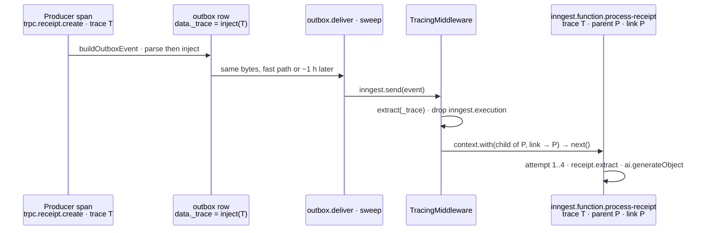

# Carry W3C trace context across the outbox in `data._trace`; the Inngest run continues the producer's trace and links to it

Technical Story: [2026-09-15 PostHog observability design](../../thoughts/designs/2026-09-15-posthog-observability.md)

## Context and Problem Statement

[adr002](adr002-canonical-postgres-store-transactional-outbox.md) commits canonical rows and outbox rows in one transaction, sends each event to Inngest after commit, and re-delivers unacked rows from an hourly `outbox-sweep`. [adr015](adr015-posthog-over-opentelemetry-via-vercel-otel.md) wants one trace id from the HTTP entry point to the Bedrock span. The gap between them is the outbox: the consumer runs in a separate Vercel invocation seconds later on the fast path, up to an hour later from the sweep, and up to four times across retries.

Inngest 4.19 does not carry the sender's trace. `inngest.send` injects no `traceparent` into the event, and each execution request starts its own `inngest.execution` root span on the global tracer (verified in `components/execution/otel/*` and `engine.js`). An Inngest event has `name`, `data`, `id`, `ts`, `v` and `user`; there is no headers slot. The outbox row stores `data jsonb` only. Every `EVENT_REGISTRY` schema is a plain `z.object`, which strips unknown keys on parse. Inngest v4 middleware hooks receive `DeepReadonly` arguments, `next()` takes no arguments, and every hook is documented "Do not mutate arguments"; the v3 `transformInput` hook no longer exists.

No standard names a key for trace context inside a message body. The CloudEvents Distributed Tracing extension defines `traceparent` and `tracestate` as envelope-level attributes, siblings of `data`, with no `baggage`. The OpenTelemetry messaging conventions state that they do "not specify the exact mechanisms on how the creation context is attached/extracted to/from messages." The OTel propagator API writes `traceparent`, `tracestate` and `baggage` into a caller-defined carrier.

How does trace context reach an Inngest run, and what is the trace relationship between the producer's request and each run?

## Decision Drivers

- **One trace id end to end.** The debugging story is "filter Logs and Traces by `trace_id`". Two ids joined by a link is a weaker story.
- **Survives the sweep.** A re-delivery an hour later must rejoin the producer's trace, not the cron's.
- **No migration, no registry change.** `EVENT_REGISTRY` keys and the outbox table shape are frozen wire contracts.
- **Read-only consumer.** Inngest v4 middleware can read the event and wrap the handler in a context; it cannot rewrite the event.
- **Cheap to switch later.** A fan-in function (`batchEvents`, `waitForEvent`) has N producers and cannot continue one of them. The design must degrade to link-only with no wire change.
- **Standard contents.** The carrier's keys should be the W3C header names written by the propagator, not a bespoke encoding.

## Considered Options

1. Continue the producer's trace and add a span link to the producer span
2. Continue the producer's trace only, no link
3. Start a new trace per Inngest run and link to the producer span

## Decision Outcome

Chosen option: "1. Continue and link", because it is the only option that meets "one trace id" today while recording, from the first row, the relationship that option 3 would need; the switch to per-run traces is then dropping the parent, not adding a wire field. See the diagram under option 1.

The posture, stated once:

1. **Pocket.** `buildOutboxEvent(name, payload)` parses the payload against the registry, then sets `data._trace` to the output of `propagation.inject(context.active(), {})`: W3C `traceparent`, `tracestate` when present, and `baggage`. The key is ours; the contents are the propagator's. Nothing else writes it.
2. **Storage.** The pocket rides in the outbox row's `data jsonb` and is sent byte-for-byte by the post-commit send and by `outbox-sweep`. Same carrier, same trace, however late the delivery. The captured `baggage` string is **persisted at rest** in that column and re-sent verbatim on sweep; this is deliberate and safe — `readBaggage`/`setBaggage` filter to the `BaggageKey` enum (member/receipt/outbox/inngest ids), every one a non-secret identifier already stored in canonical rows. No session token or secret can reach the pocket, because it is not a baggage key. `events.test.ts` asserts a persisted `_trace.baggage` carries no key outside `BaggageKey`.
3. **Restore.** `TracingMiddleware.wrapFunctionHandler` reads `ctx.event.data._trace`, calls `propagation.extract(ROOT_CONTEXT, carrier)`, starts `inngest.function.<id>` as a child of the producer span with a link to that same span, sets Baggage `inngest.run_id` and `inngest.attempt`, and runs `next()` inside `context.with`. Each retry repeats this under the same trace id.
4. **Not stripped.** The event is never rewritten. `event.data` is `any` in v4 with no `schemas` option; handlers pick fields by name (`event.data.receiptId`) and services never see `event.data`. The Inngest dashboard shows `_trace` exactly as sent, which doubles as a manual correlation path.
5. **Missing pocket.** If `_trace` is absent or does not parse (an event sent by hand from the Inngest dashboard, a row written before this decision), the run starts a new root trace and logs `event.name=trace.carrier.missing` at `warn` (adr015: `eventName` on the record, mirrored as an attribute). It never fails the run.
6. **Inngest's own root is dropped.** The adr015 boot samples through `NameDropSampler` (`src/server/observability/sampler.ts`), which returns `NOT_RECORD` for spans named `inngest.execution` in front of `ParentBasedSampler({ root: AlwaysOnSampler })`, so the timeline shows our function span under the producer, not an unrelated Inngest root.
7. **Fan-in switch.** The first function that consumes N events starts a new trace per run and links to every carrier (option 3 semantics). No producer or wire change.

Carrier locations rejected, one line each:

- **A new `trace_context` column on `outbox`.** A migration and a schema change for a value only the middleware reads; `data jsonb` already survives the round trip.
- **Inngest native propagation.** Verified absent in 4.19: the SDK starts its own root and reads no sender `traceparent`.
- **`event.user`.** Semantically the actor; Member identity already rides in Baggage.
- **Inject at `wrapSendEvent`.** Read-only, and it would stamp the sweep cron's context on a re-delivery instead of the producer's.

### Positive Consequences

- One `trace_id` from `POST /api/trpc/receipt.create` or the Resend webhook, through `outbox.deliver`, into every attempt of `process-receipt` and the Bedrock span.
- A sweep re-delivery lands in the original trace, visibly late, instead of as an orphan under a cron span.
- No migration. `EVENT_REGISTRY`, the golden test, function ids and the outbox schema are untouched.
- Contents are propagator output, so `tracestate` and any future propagator ride along without code changes.
- The link exists from day one; the per-run-trace switch adds nothing to the wire.
- `_trace.traceparent` is readable in the Inngest dashboard for hand correlation with PostHog.

### Negative Consequences

- Traces get long. Three retries plus a sweep re-delivery can stretch one trace over an hour. A future reconciliation or CDR batch that spans days would need option 3. That is the first switch signal.
- The producer's sampling decision binds every run. Differential sampling (keep every worker span, sample HTTP) needs option 3. Second switch signal.
- Every producer is trusted. `propagation.extract` drops a malformed `traceparent` (empty context, new root), but a valid foreign one would join a stranger's trace. All producers are our own code today; an untrusted producer is the third switch signal.
- `_trace` is visible to any future handler that spreads `event.data` into a write or hashes it for idempotency. Rule: handlers pick named fields, never spread `event.data`. Idempotency keys on the outbox row `id` (adr002), so nothing hashes `data` today.
- Inngest's own trace view (`extendedTracesMiddleware`, dashboard traces) is not correlated with ours and stays a separate surface.
- Inngest's server sends a `traceparent` header on each execution request, so Next's `POST /api/inngest` HTTP span parents onto Inngest's trace, not ours. Its parent is Inngest's remote span, never exported to us, so that HTTP span is a rootless orphan (it was before the `inngest.execution` drop too): hidden from PostHog's root-keyed trace lists, reachable by id only. Our `inngest.function.*` span is unaffected — it parents onto the pocket, not the HTTP span. Accepted; dropping the HTTP span too would lose request-level timing for every run.
- Whether PostHog's Traces UI renders and navigates span links is unverified. Matters only when the option 3 switch happens.
- Whether OTel context survives Inngest's `step.run` boundary without `wrapStep` is unverified. No handler uses steps today; check when the first one does, and add `wrapStep` with the same `context.with` if not.
- A few hundred bytes per outbox row. Negligible.

## Pros and Cons of the Options

### 1. Continue the producer's trace and add a span link

| Pros                                                                              | Cons                                                                        |
| --------------------------------------------------------------------------------- | --------------------------------------------------------------------------- |
| One trace id; one filter reads the whole story                                    | Trace duration runs from producer to last attempt; an hour is possible      |
| The link is already recorded, so the switch to option 3 is "drop the parent"     | The producer's sampling decision governs the run                            |
| Late sweep deliveries appear in the right trace, visibly late                     | Parent and link point at the same span today; the link is redundant until the switch |
| Fan-in degrades to link-only on the same wire                                     | A foreign valid `traceparent` would be trusted                              |

### 2. Continue the producer's trace only

- Good, because it is the simplest wire and gives the same trace id.
- Bad, because a later switch to per-run traces loses the producer relationship entirely until a link is added, so the code change happens under pressure instead of now.
- Bad, because fan-in has no expression: N parents, pick one, lose the rest.

### 3. New trace per Inngest run, linked to the producer

- Good, because each run is a bounded trace; sampling and retention are decided per run; fan-in is natural (N links).
- Good, because a foreign or malformed producer context cannot pollute a run's trace.
- Bad, because the debugging story becomes two hops: find the run trace, follow the link back. Whether PostHog's trace UI renders and navigates span links was not verified.
- Bad, because the stated goal, one trace id from email to Bedrock, is not met; correlation is by link, not id.
- Bad, because it is premature: no fan-in function exists yet.

## Links

- Design: [2026-09-15 PostHog observability](../../thoughts/designs/2026-09-15-posthog-observability.md)
- Refines: [adr015](adr015-posthog-over-opentelemetry-via-vercel-otel.md) — the transport this carrier feeds
- Refined by: [adr020](adr020-server-rooted-traces.md) — the producer span this pocket captures is now the trace root
- Extends: [adr002](adr002-canonical-postgres-store-transactional-outbox.md) — the pocket rides in the outbox row's `data`; clause 7's registry is unchanged
- Fits: [adr004](adr004-domain-oriented-3-tier-server-architecture.md) — the middleware is bound once in `src/server/inngest/client.ts`; tiers are unaware
- Standards: [W3C Trace Context](https://www.w3.org/TR/trace-context/), [W3C Baggage](https://www.w3.org/TR/baggage/), [CloudEvents Distributed Tracing extension](https://github.com/cloudevents/spec/blob/main/cloudevents/extensions/distributed-tracing.md) (envelope-level, for contrast), [OTel messaging conventions](https://opentelemetry.io/docs/specs/semconv/messaging/messaging-spans/) (mechanism unspecified)
- SDK: Inngest 4.19 `components/middleware/middleware.d.ts` — read-only hooks, `wrapFunctionHandler` for AsyncLocalStorage context
