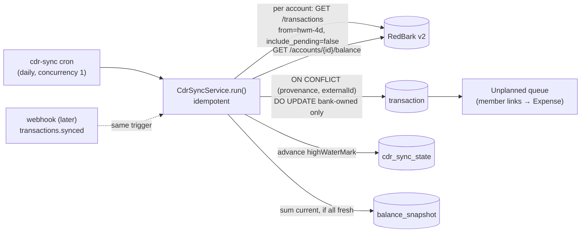

# Sync bank transactions via the RedBark CDR aggregator with the app as store-of-record, provenance-keyed dedup, and a poll-first worker

Technical Story: [Expense Linking, Receipts, Cash Flow — Roadmap Design, stage 7](../../thoughts/designs/2026-08-16-expense-linking-receipts-cashflow.md)

## Context and Problem Statement

The household ledger is entered by hand or imported from statement CSVs. Stage 7 of the roadmap replaces that toil with a daily bank sync through [RedBark](https://redbark.com/docs/api-reference/v2/overview), a CDR (Consumer Data Right / open banking) aggregator. Banks are linked once in RedBark's dashboard; a single account-level API key then reads every linked account's settled transactions and balances.

Everything else in the app reads the local `transaction` table: expense links (`expenseId`, [adr010](adr010-single-nullable-fk-transaction-expense-link.md)), categorisation, receipt matching, and the cash-flow projection. A synced transaction has to become an ordinary ledger row, not a live view onto a third party. It also has to survive re-ingestion: sync windows overlap to catch late-posting rows, and RedBark's webhooks (a later trigger) deliver at-least-once, so the same transaction arrives repeatedly. And a member may rename, categorise, or link a synced row — those edits must not be clobbered by the next sync.

Two constraints are specific to this integration. First, RedBark v2 is **in beta**, and the facts that matter most are underspecified: the REST transaction `amount` is a `Money` object in integer minor units whose **sign convention is undocumented** (only the legacy pre-v2 webhook payload states "negative for debits"), and `status`/`direction` are bare strings with no enum on the REST surface. Second, a bank consent can lapse — RedBark exposes a connection `status` of `pending|active|expiring|expired|invalidated|revoked` — and a dead connection is a business state to surface, not a transient error to retry.

How should the app ingest external CDR transactions so that the local ledger stays authoritative, re-ingestion is idempotent, member edits are preserved, and a beta API's surprises fail loud rather than mis-post?

## Decision Drivers

- **App stays store-of-record.** Synced rows must be ordinary `transaction` rows so expense links, categorisation, receipts, and the projection keep working unchanged.
- **Idempotent / at-least-once.** Overlapping poll windows and at-least-once webhooks re-deliver the same transaction; re-ingest must neither duplicate nor mutate what a member touched.
- **Member edits are sacred.** A renamed, categorised, or expense-linked synced row survives every re-sync.
- **Complexity must be earned** (pre-PMF, one developer — echoes [adr006](adr006-redis-session-cache-with-postgres-durable-copy.md)). No per-account balance history, no connection table, no transfer or cross-provenance consolidation engine until a need is real.
- **Beta API, undocumented specifics.** The REST amount sign and `status`/`direction` enums are undocumented; the design fails loud on disagreement rather than silently posting a refund as a purchase.
- **Consent lifecycle is first-class.** A `revoked|expired|invalidated` connection stops sync and surfaces; it is not retried.

## Considered Options

1. **App store-of-record; poll-first; provenance-keyed dedup.** Postgres owns the ledger. A daily cron pulls settled transactions per account, upserts them keyed on `(provenance, externalId)`, tracks a per-account cursor in a new `cdr_sync_state` table, and auto-anchors the balance line. Webhooks are a later, additive trigger of the same idempotent service.
2. **RedBark as store-of-record / on-demand mirror.** Don't persist synced rows; query RedBark live at read time.
3. **Webhook-push-only.** Receive rows solely from `transactions.synced` webhooks; no polling backstop.
4. **Manual CSV import only (status quo).** Keep hand-importing statements.

## Decision Outcome

Chosen option: **"1. App store-of-record; poll-first; provenance-keyed dedup"**, because it is the only option that keeps the local ledger authoritative while paying for dedup exactly once (three columns) and degrading safely on a beta API — see the flow under option 1. Status is **In Progress**: the architecture is settled and agreed, but two items block full acceptance (see Open Questions) — the REST sign-convention sandbox spike and RedBark's beta status.

The facet decisions that make up this option:

1. **Provenance model.** A Postgres `pgEnum` `transaction_provenance` (`manual | import | cdr | paypal`) plus `externalId` (text) and `accountName` (text) on `transaction` — matching the `pgEnum` pattern of `transaction_frequency`/`transaction_priority`, not a bare `text` column. Uniqueness is a **partial** index `(provenance, externalId) WHERE externalId IS NOT NULL`, so unlimited manual rows (NULL `externalId`) coexist with one row per `(cdr, txn.id)`.
2. **Dedup key = `(cdr, redbark txn.id)`.** The unique index is the dedup. Re-ingest is `ON CONFLICT (provenance, externalId) DO UPDATE` scoped to **bank-owned columns only** — `amount`, `date`, `accountName` — and never touches member-owned columns (`expenseId`, `expenseCategoryId`, `category`, `priority`, `frequency`, `notes`). `description` is **INSERT-only**: bank raw text lands once, the member owns it after.
3. **Settled only.** Sync sends `include_pending=false` (the API default). A Transaction is "money that actually moved" (glossary); pending amounts are volatile and match receipts badly. With settled-only, the `ON CONFLICT` update is normally a no-op.
4. **Sign + amount mapping (defensive, pending spike).** App glossary is Spend-positive / Inflow-negative — the opposite of CDR's account-holder view. The mapping prefers the `direction` field when present (`debit`→Spend positive, `credit`→Inflow negative), cross-checks it against the numeric sign, and **fails loud on disagreement**; numeric-negation is the fallback only when `direction` is absent. `Money.amount` (integer minor units) is converted to dollars (÷100) and `currency` is asserted `== "aud"` — single-currency; multi-currency is out of scope. The mapping is pinned in a unit test against a real sandbox row before it is trusted.
5. **App is store-of-record via `cdr_sync_state`.** New `cdr` domain, one row per account (forced by the API — `GET /transactions` takes exactly one `account`): `accountId` (unique), `connectionId`, `accountName`, `highWaterMark` (newest ingested txn `datetime`), `connectionStatus` (denormalized mirror of RedBark connection status), `lastSyncedAt`, `lastError`. Each run fetches `from = highWaterMark − 4d` (overlap re-catches late-posting rows; the unique index makes it idempotent), follows `next_page_url` to null, upserts, then advances the mark. First sync (`highWaterMark` null) backfills **90 days**. The one account already manually imported since January is handled by **seeding its `highWaterMark`** at setup to where its manual data ends, so CDR starts after the manual rows — no cross-provenance duplicate period.
6. **Balance auto-anchor.** Sync sums each active account's `current` balance (settled ledger, not `available`) into one household-wide `balance_snapshot` row (the table stays single-number), gated on **all** accounts reporting `freshness: fresh` — otherwise the run skips the anchor rather than poison the line. `asOf` = the oldest `observed_at` summed. A `source` column (`manual | cdr`, default `manual`) is **added as a label only** (UI honesty: "synced" vs "you entered this"); precedence stays pure latest-`asOf` (tiebreak `id desc`). The sum reflects **linked accounts only** — unlinked funds need a manual override row.
7. **Poll-first; webhook later.** A daily Inngest scheduled function `cdr-sync` (concurrency 1) calls the idempotent `CdrSyncService.run()`. Because `run()` is idempotent, webhooks are a free additive trigger later: RedBark's **webhook destination** (`transactions.synced`, verify `X-Redbark-Signature: sha256=<hex>` over `<timestamp>.<body>`, dedup `X-Redbark-Delivery-Id`) enqueues the same `run()`; its **event destination** (`connection.*`, verify the Stripe-style `Redbark-Signature: t=,v1=`) flips `connectionStatus`. The two verifiers must not be conflated.

Construction follows the 3-tier pattern ([adr004](adr004-domain-oriented-3-tier-server-architecture.md)) with `receipts/` as the reference — `cdr.controller.ts` / `cdr.service.ts` / `cdr.repository.ts` / `cdr.schema.ts` / `cdr.redbark.ts` (the `interface RedbarkClient` + `class HttpRedbarkClient`). This supersedes the design doc's stale `makeRun*(deps)` note, written before [adr004](adr004-domain-oriented-3-tier-server-architecture.md)'s 2026-09-09 revision ended the earlier deferral and reinstated the 3-tier as the live pattern. Sync writes take **no outbox event** (the cron is the trigger; receipt matching is read-time, so no consumer needs one); each account's upsert + high-water-mark advance run in **one `db.transaction()`** so a mid-account failure never advances the cursor past un-ingested rows. `cdr-sync`'s id + cron are pinned in `registry-golden.test.ts`.

**Credential & consent posture.** One `rbk_live_…` bearer key in `REDBARK_API_KEY` — **optional, not `requiredInProd`**: CDR is not core, so an unset key makes the cron a no-op. `Redbark-Version` is pinned as a **code constant**, not env (a version bump can change parsing; it moves through code review + a test). The key is set via the same Terraform→Vercel path as `RESEND_API_KEY` ([adr013](adr013-terraform-owned-vercel-deployments.md)). Failure posture is asymmetric (an outbound echo of [adr007](adr007-asymmetric-failure-posture-in-the-redis-adapter.md)): transient errors (network, 5xx, `429`) retry with backoff honoring `Retry-After`; consent death (`revoked|expired|invalidated`) is terminal — write `connectionStatus`, stop that connection's accounts, surface it; `expiring` is a soft warning. This differs from [adr006](adr006-redis-session-cache-with-postgres-durable-copy.md)/adr007, which govern *inbound session* creds cached in Redis with fail-open/fail-closed on a cache miss. Here there is a single *outbound* key and consent lifecycle is a first-class business state, not a cache miss.

### Positive Consequences

- The local ledger stays authoritative; synced rows are ordinary `transaction` rows, so expense links, categorisation, receipts, and the projection work unchanged.
- Re-ingestion is idempotent by construction (partial unique index + high-water-mark + settled-only), so poll and future webhooks are interchangeable, raceless triggers.
- Member edits survive re-sync — the scoped `ON CONFLICT` update and INSERT-only `description` protect every editable column.
- A beta API's undocumented sign fails loud (direction-vs-numeric cross-check) rather than mis-posting a refund as a purchase.
- The provenance columns are paid for once and also serve future `paypal` and manual `import` provenances.
- Synced Spend with no link lands in the **Unplanned** queue, reusing the existing "absence of a plan is derived" flow — no new surface.

### Negative Consequences

- **Internal transfers double-count.** Linking two household accounts surfaces a transfer as paired Spend + Inflow. Transfer-filtering is explicitly deferred to a later design.
- **Cross-provenance consolidation is unsolved.** The unique index dedups within a provenance only; the same purchase arriving as both `cdr` and `paypal` (or overlapping a manual `import`) is not merged. The one known overlap — the account manually imported since January — is avoided by seeding its high-water-mark; the general case is out of scope.
- **Balance anchor reflects linked accounts only.** Unlinked funds require a manual override row.
- **Sign mapping is unverified until a sandbox spike** (see Open Questions); the ADR is In Progress until it is pinned.
- Denormalized `connectionStatus` will want promoting to a `cdr_connection` table if the project launches publicly and households manage their own connections on `/settings`.
- RedBark's hierarchical categories are not adopted; synced rows land uncategorised pending a later review of that taxonomy.

## Pros and Cons of the Options

### 1. App store-of-record; poll-first; provenance-keyed dedup

| Pros | Cons |
| --- | --- |
| Local ledger authoritative; everything downstream unchanged | Provenance columns + a new table + a new domain to build |
| Idempotent; poll and webhook interchangeable | Transfers and cross-provenance dedup left unsolved |
| Member edits protected by scoped upsert | Balance anchor covers linked accounts only |
| Degrades safely on a beta API (fail-loud sign, freshness gate, optional key) | Sign mapping unverified until a sandbox spike |

### 2. RedBark as store-of-record / on-demand mirror

- Bad, because every read couples to a beta external API and its rate limits (`cheap` 60/min).
- Bad, because expense-link FKs, receipt matches, and manual entry have no external row to attach to — it breaks the existing model.
- Bad, because offline / API-down means no ledger at all.
- Good, because there is nothing to sync or dedup.

### 3. Webhook-push-only

- Bad, because a missed or failed delivery is a silent gap with no backstop, on a beta service of unknown reliability.
- Bad, because backfill and re-derivation still need a pull path, so this doesn't remove polling — it just hides it.
- Good, because latency to new rows is lower than a daily poll — which is why it is retained as an *additive* trigger in option 1, not the primary one.

### 4. Manual CSV import only (status quo)

- Good, because zero new code, zero external dependency.
- Bad, because it is exactly the manual toil this feature exists to remove.

## Open Questions

- **REST amount sign convention.** The v2 REST transaction leaves `amount` sign and `direction`/`status` enums undocumented; only the legacy webhook payload says "negative for debits." Resolve with a `livemode:false` sandbox spike and pin the confirmed mapping in a unit test before trusting it. Until then, the sign facet is not Accepted.
- **RedBark v2 is in beta** (`2026-10-01.wattle`). Endpoint shapes and enums may shift; the `RedbarkClient` adapter isolates the blast radius, but GA should be confirmed before production sync.
- **Transfer-filtering** and **general cross-provenance consolidation** are deferred to their own designs.

## Links

- Design: [Expense Linking, Receipts, Cash Flow — Roadmap Design](../../thoughts/designs/2026-08-16-expense-linking-receipts-cashflow.md)
- Builds on [adr002](adr002-canonical-postgres-store-transactional-outbox.md) — outbox + Inngest rails
- Builds on [adr004](adr004-domain-oriented-3-tier-server-architecture.md) — 3-tier domain architecture (`receipts/` reference)
- Builds on [adr005](adr005-per-domain-drizzle-schema-files.md) — per-domain Drizzle schema files
- Contrasts with [adr006](adr006-redis-session-cache-with-postgres-durable-copy.md) / [adr007](adr007-asymmetric-failure-posture-in-the-redis-adapter.md) — inbound session creds vs an outbound API key + consent lifecycle
- Contrasts with [adr014](adr014-bedrock-via-vercel-oidc.md) — Bedrock's OIDC-exchanged creds vs a static outbound key
- Vendor docs: [RedBark API v2 overview](https://redbark.com/docs/api-reference/v2/overview)
