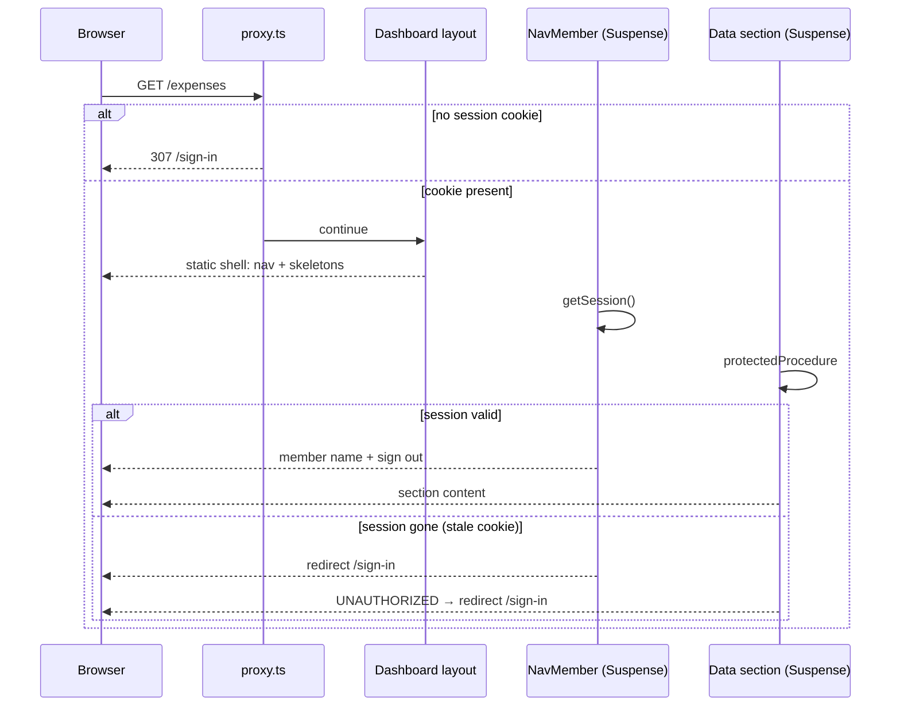

# Gate dashboard routes on cookie presence in `proxy.ts`; validate the session inside Suspense

Design: [2026-10-02 Loading states and Partial Prerendering](../../thoughts/designs/2026-10-02-loading-states-and-ppr.md)

## Context and Problem Statement

`src/app/(dashboard)/layout.tsx` awaits `getSession()` at the top and redirects to `/sign-in` when it returns nothing. Every dashboard page renders under that await, so the nav, page header and any loading state wait for a session read before the first byte paints.

The loading-states design turns on `cacheComponents` so each route ships a prerendered static shell (nav + skeletons) and streams data into it (PPR). Under `cacheComponents`, a runtime read such as `headers()` outside `<Suspense>` fails the build, and `loading.tsx` does not cover runtime reads in its own layout (`node_modules/next/dist/docs/01-app/03-api-reference/03-file-conventions/loading.md:88-93`). A session read at the top of the layout therefore either blocks the whole shell or must move.

The data is already protected below the layout. `protectedProcedure` (`src/server/api/trpc.ts:197`) throws `UNAUTHORIZED` without a session, and the receipt route handlers under `src/app/api/receipts/` check the session themselves. The layout check decides what a signed-out visitor *sees*, not what data they can reach.

Where does the dashboard decide "signed out → `/sign-in`", so that the shell can prerender and a signed-out visitor never sees the app?

## Decision Drivers

- **Static shell.** The nav and skeletons must ship in the prerendered shell. Any session read above them blocks it.
- **No app frame for signed-out visitors.** A visitor with no session cookie gets a redirect before any dashboard markup renders.
- **Security lives at the data layer.** The Next docs warn that a matcher change can silently drop Proxy coverage and tell you to verify auth inside each data access (`node_modules/next/dist/docs/01-app/03-api-reference/03-file-conventions/proxy.md:251`). The gate is UX, not the lock.
- **Cheap per request.** Proxy runs on every matched request. Session reads already cost a Redis read, with Postgres as the fallback ([adr006](adr006-redis-session-cache-with-postgres-durable-copy.md)); the gate must not add another.
- **Stale cookie redirects cleanly.** A cookie whose session is gone (signed out on another device, revoked) must land on `/sign-in`, not on a page of "Couldn't load" cards.

## Considered Options

1. **Cookie-presence gate in `proxy.ts` + session check inside Suspense.** `getSessionCookie` from `better-auth/cookies`; `NavMember` and `protectedProcedure` validate.
2. **Keep the blocking layout check; mark the layout `export const instant = false`.** No proxy.
3. **Session check inside Suspense only.** No proxy; `NavMember` redirects.
4. **Full session check in `proxy.ts`.** `auth.api.getSession` per request.

## Decision Outcome

Chosen option: "1. Cookie-presence gate in `proxy.ts` + session check inside Suspense", because it is the only option that keeps the static shell *and* redirects signed-out visitors before render, at no per-request storage cost. See the diagram under option 1.

The rule sits in a pure `authRedirect(pathname, hasCookie)` with a unit test. The matcher covers dashboard routes and excludes `/sign-in`, `/sign-up`, `/api` and static assets. Proxy never redirects the auth pages on cookie presence; an expired cookie would loop between `/` and `/sign-in`.

A stale cookie redirects through `UNAUTHORIZED`. The RSC caller (`src/trpc/server.ts`) maps it to `redirect("/sign-in")`, which `catchError` passes through, and the client `QueryCache` `onError` (`src/trpc/query-client.ts`) does the same for client queries. `NavMember`'s own redirect is the backstop.

### Positive Consequences

- The dashboard layout renders `AppNav` / `MobileNav` at once; under `cacheComponents` the nav and skeletons ship in the static shell.
- A visitor with no cookie gets a 307 to `/sign-in` with no flash of the app.
- Proxy touches no Redis or Postgres. Session reads stay where they are: one `getSession()` per render (React `cache()`), one per tRPC request.
- Signing in shows the shell and per-section skeletons straight after the button spinner, not a full-page splash.

### Negative Consequences

- The layout no longer gates the tree. A future server component that reads data outside tRPC must check the session itself; the layout will not catch it. A reader expecting a layout guard will be surprised. This includes server-only values passed as props: an `env` read in a page reaches a fake-cookie response unless a `getSession()` check runs first (`settings/page.tsx`, `receipts/page.tsx`).
- Two gates to keep honest: the proxy matcher and `protectedProcedure`. A matcher slip degrades UX (a signed-out visitor sees the shell, then redirects), not data safety.
- The stale-cookie redirect needs the `UNAUTHORIZED` mapping in two places, server caller and client cache.
- A signed-in Member who opens `/sign-in` sees the form briefly before `RedirectIfSignedIn` (inside Suspense) sends them to `/`.
- Neutral: a revoked session can stay valid for up to 60s through better-auth's `cookieCache` (`src/server/auth/config.ts`). The old layout check had the same window, and this decision leaves it unchanged.
- Neutral: `/api` stays outside the gate, as it already sits outside the layout today. Route handlers keep checking the session themselves.

## Pros and Cons of the Options

### 1. Cookie-presence gate in `proxy.ts` + session check inside Suspense

| Pros | Cons |
| ----- | ----- |
| Static shell prerenders; nav paints at once | The layout no longer guards the tree, which surprises a reader |
| No cookie → 307 before render | Stale cookie needs an `UNAUTHORIZED` → redirect mapping, server and client |
| No storage call in proxy | Signed-in Member sees `/sign-in` form briefly before redirect |
| Matches the Next guidance: proxy optimistic, data layer authoritative | Matcher and procedure gate must both stay correct |

### 2. Keep the blocking layout check; `instant = false`

- Good, because nothing moves: one gate, in the layout, where a reader expects it.
- Good, because a signed-out visitor never sees the app.
- Bad, because every dashboard navigation blocks on the session read. The nav, header and skeletons wait with it, so the dashboard gets no static shell and most of the PPR gain is lost.
- Bad, because `instant = false` only declares the block allowed; it does not remove it. Every navigation into the dashboard from outside still waits on the session read.

### 3. Session check inside Suspense only (no proxy)

- Good, because the shell prerenders and there is no second gate to maintain.
- Bad, because a signed-out visitor gets a 200 with the app frame and skeletons, then a streamed redirect. `curl -I` shows no 307.
- Bad, because the data sections race the redirect: each `protectedProcedure` call fails, so "Couldn't load" cards can flash before `NavMember` redirects.

### 4. Full session check in `proxy.ts`

- Good, because the gate is exact: stale cookies redirect before render too.
- Bad, because every matched request, prefetches included, pays a Redis read (Postgres on a miss), on top of the reads the render and tRPC already make.
- Bad, because it duplicates `protectedProcedure`'s job in a place the Next docs call unreliable as the only check.

## Resolved Questions

- A pending prefetch that rejects streams to the client as a dehydrated error, which TanStack may redact. Does the `UNAUTHORIZED` → `/sign-in` mapping still fire on that path? **Yes, resolved in Stage A (loading-states plan, Phase 2):**
  - Redaction is off (`dehydrate.shouldRedactErrors: () => false` in `src/trpc/query-client.ts`), so the rejected prefetch reaches the client with its `NEXT_REDIRECT` digest and `catchError` passes it to the router. Flight still strips error messages in production.
  - Auth errors aren't retried. The query `retry` skips `UNAUTHORIZED` and the `/sign-in` redirect digest (`isAuthError`, `src/trpc/auth-errors.ts`), so the redirect doesn't wait out about 7s of backed-off retries.
  - A plain `useQuery` holds a streamed redirect without throwing, so the `QueryCache` `onError` sends any `isAuthError` to `/sign-in` with a full page load (`src/trpc/query-client.ts`).
  - `NavMember`'s redirect stays as the backstop.
  - Verified with a revoked session after the 60s `cookieCache`. Every dashboard route, on a hard load and on a client navigation into it, lands on `/sign-in` with no "Couldn't load" card. It lands with a full page load, even where a soft redirect would do (a click from `/` to `/expenses`), because the cache's redirect fires too.

## Links

- Design: [2026-10-02 Loading states and Partial Prerendering](../../thoughts/designs/2026-10-02-loading-states-and-ppr.md)
- Related: [adr006](adr006-redis-session-cache-with-postgres-durable-copy.md), the session read cost the gate avoids
- Vendor docs: `node_modules/next/dist/docs/01-app/03-api-reference/03-file-conventions/proxy.md`, `node_modules/next/dist/docs/01-app/03-api-reference/03-file-conventions/02-route-segment-config/instant.md`
