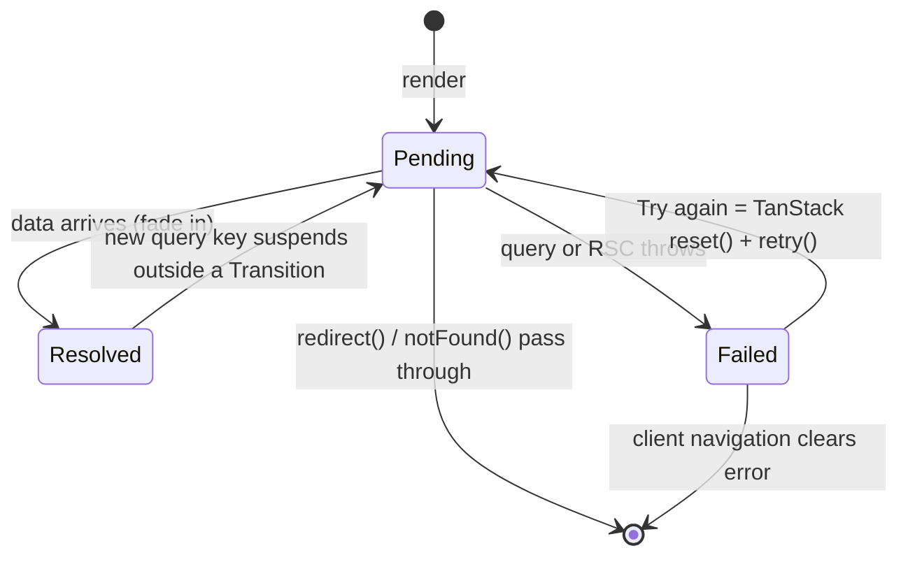

# Add every loading region through `AsyncBoundary` (`catchError` + `<Suspense>`), enforced by Biome

Design: [2026-10-02 Loading states and Partial Prerendering](../../thoughts/designs/2026-10-02-loading-states-and-ppr.md)

## Context and Problem Statement

The app has one hand-written `<Suspense>` (`src/app/(dashboard)/_components/cash-flow-chart.tsx:75`), one `error.tsx` (`expenses/unplanned`) and no `loading.tsx`. Views call `useSuspenseQuery` with no boundary above them, so a hard load waits for every query and a client navigation freezes the old page.

The loading-states design adds about fifteen loading regions: three on the dashboard, one per settings panel, one per list page, the nav member slot and the sign-in redirect gate. Each region needs the same five things:

- A skeleton of the right height.
- A visually hidden `role="status"` and `aria-busy`.
- A fade-in that respects reduced motion.
- An error card that fails only that section.
- A Try again that actually refetches.

Retry has two halves. TanStack suspense errors need `useQueryErrorResetBoundary().reset()` before a re-render refetches, and Server Component errors need a server re-fetch. The boundary must also let `redirect()` through: [adr026](adr026-optimistic-proxy-auth-gate.md) relies on sections redirecting a stale-cookie Member to `/sign-in`.

How should a page add a loading region so that every region behaves the same, and how is that kept true as pages are added?

## Decision Drivers

- **Same behaviour everywhere.** Skeleton, status text, fade and error card must not drift between pages. A region that forgets `role="status"` or the error boundary is a silent regression.
- **Failure stays in its section.** One failing query must not blank the page or the nav.
- **Retry recovers.** Try again must refetch both server-rendered and TanStack data, not just re-render a cached error.
- **Framework-aware.** `redirect()` and `notFound()` throw special errors; the boundary must pass them through, not render an error card.
- **No new dependency, small surface.** Pre-PMF, one developer. Prefer what Next 16.3 already ships.
- **Enforceable without review.** A rule that only lives in a doc drifts.

## Considered Options

1. **`AsyncBoundary` on Next's `catchError` + `<Suspense>`, the only way, with a Biome import ban.**
2. **`AsyncBoundary` on `react-error-boundary` + `<Suspense>`.**
3. **Route-level only: `loading.tsx` + `error.tsx` per segment.**
4. **Hand-written `<Suspense>` (and error boundary) at each site.** No wrapper.

## Decision Outcome

Chosen option: "1. `AsyncBoundary` on Next's `catchError` + `<Suspense>`", because it is the only option that meets every driver: one shared component, section-level isolation, a `retry()` that re-fetches Server Components, `redirect()` / `notFound()` passed through, and no new dependency. See the diagram under option 1.

`AsyncBoundary` (`src/components/async-boundary.tsx`) takes `skeleton`, `label` and `fade` (default `true`). `skeleton={null}` is allowed for invisible gates, which also fail invisibly: no error card, error still logged. Content fades in only if the skeleton showed. Try again calls TanStack's `reset()`, then `catchError`'s `retry()`. It never calls `catchError`'s own `reset()`, because that re-renders without re-fetching and does not recover Server Component errors.

Biome's `noRestrictedImports` bans `Suspense` from `react` and `catchError` from `next/error`, and a top-level `overrides` entry lifts the ban for `async-boundary.tsx` only. The lint message names `AsyncBoundary`.

### Positive Consequences

- Skeleton, status text, fade and error card live in one file. Fixing a11y or motion once fixes every region.
- A failing section shows "Couldn't load {label}" with Try again; the nav, header and other sections keep rendering.
- adr026's stale-cookie `redirect("/sign-in")` passes straight through every section.
- `make check` and the editor reject a hand-written `<Suspense>`, so the rule holds without review.
- No new dependency; the error state clears on client navigation for free.

### Negative Consequences

- Every page depends on one component. A bug in `AsyncBoundary` hits every route, so it carries jsdom behaviour tests (design decision 13).
- A need the props don't cover, such as a custom error card, means changing the shared component rather than writing a one-off boundary.
- `catchError` is new in Next 16.3, with few examples outside the Next docs. It ties error recovery to Next, which the App Router already does.
- Retry is two calls in a fixed order, TanStack `reset()` then `retry()`. Swapping the order or using `catchError`'s `reset()` shows the error again.
- The lint ban surprises a reader who expects plain `<Suspense>`. It also misses `React.Suspense` reached through a namespace import; the codebase uses named imports.
- Neutral: route `error.tsx` / `loading.tsx` files stay allowed as safety nets. They are file conventions, not imports, so the ban does not touch them.

## Pros and Cons of the Options

### 1. `AsyncBoundary` on `catchError` + `<Suspense>`, Biome ban

| Pros | Cons |
| ----- | ----- |
| One file owns skeleton, a11y, fade, error card | Every route depends on it; needs behaviour tests |
| `retry()` re-fetches Server Components | `catchError` is new; few examples |
| Passes `redirect()` / `notFound()` through | Retry needs two calls in order |
| No dependency; clears on navigation | Lint ban misses `React.Suspense` |

### 2. `AsyncBoundary` on `react-error-boundary` + `<Suspense>`

- Good, because it is mature and the TanStack docs pair it with `QueryErrorResetBoundary`.
- Good, because `resetKeys` resets the boundary from props.
- Bad, because it adds a dependency for behaviour Next 16.3 ships.
- Bad, because it catches `redirect()` / `notFound()` errors unless each fallback rethrows them (`unstable_rethrow`), which breaks adr026's stale-cookie redirect if forgotten.
- Bad, because its reset re-renders without re-fetching Server Components; recovery needs a manual `router.refresh()`.

### 3. Route-level only: `loading.tsx` + `error.tsx`

- Good, because there is no new code and Next wires it per segment.
- Bad, because each route gets one skeleton and one failure: a dashboard with three sections loads and fails as one block.
- Bad, because `loading.tsx` does not cover runtime reads in its own layout, so `NavMember` would still block the shell.
- Bad, because it cannot bound a client re-suspend, such as the cash flow period toggle.

### 4. Hand-written `<Suspense>` at each site

- Good, because each site picks exactly the fallback it needs, with no abstraction.
- Bad, because about fifteen sites each repeat the skeleton, status text, fade and error boundary, and drift is likely.
- Bad, because a site that forgets the error boundary sends its error to the route `error.tsx`, blanking the page.
- Bad, because nothing enforces it.

## Links

- Design: [2026-10-02 Loading states and Partial Prerendering](../../thoughts/designs/2026-10-02-loading-states-and-ppr.md)
- Related: [adr026](adr026-optimistic-proxy-auth-gate.md), whose stale-cookie redirect passes through this boundary
- Related: [adr008](adr008-shadcn-on-base-ui-for-shared-primitives.md), the shared-primitive direction `AsyncBoundary` and the skeletons extend
- Vendor docs: `node_modules/next/dist/docs/01-app/03-api-reference/04-functions/catchError.md`
