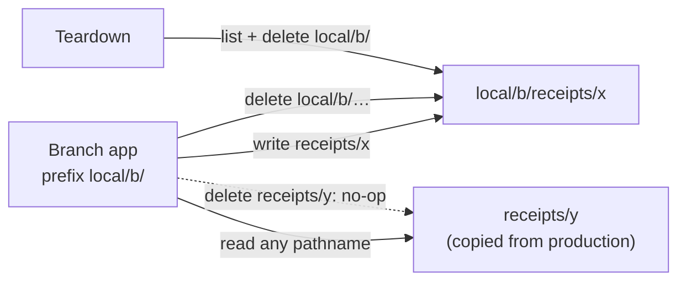

# Branch Blob files with the database by a pathname prefix per Neon branch, in one shared store

Plan: [2026-10-08 Blob files branch with the database](../../thoughts/plans/2026-10-08-blob-branch-prefix.md)

## Context and Problem Statement

Neon gives every git branch its own database. `scripts/neon-branch.sh` makes `local/<branch>` for local dev, and the Neon-Vercel integration makes `preview/<branch>` for each preview deploy. Each starts as a copy of production, so a branch database holds production's Receipt rows.

Vercel Blob has no branching. One store serves production, preview and development, and every environment holds the same read/write token. A branch's copied Receipt row points at production's file, so deleting that Receipt on a branch deletes production's file. The step-7 browser check (2026-10-08) found this. The only guard was an `AGENTS.md` line: "only delete rows you made on the branch".

Vercel Blob (docs, Aug–Sep 2026) has no environment or branch on a store, no read-only tokens and no copy between stores. `copy()` works only inside one store. Its advice is to use separate stores to isolate environments, and to treat blobs as immutable.

How do Blob files follow the Neon branch, so branch work can't change production's files but can still read the Receipts it copied?

## Decision Drivers

- **Production files are safe from branch work.** No delete or overwrite from a `local/` or `preview/` branch may touch a production file, whatever the developer or agent does.
- **A branch sees what it copied.** A Receipt copied into a branch shows its image and can be re-extracted, the same as Neon's copy-on-write for rows.
- **Branch files die with the branch.** Closing a PR or `make db_branch_delete` cleans up, so personal receipt data doesn't pile up.
- **Services don't know the environment.** adr004 puts the provider behind the adapter tier. Receipts and email code keep passing plain keys like `receipts/email/<uuid>.pdf`.
- **Small surface.** Pre-PMF, one developer. No new store, no new paid feature.

## Considered Options

1. **One store, a pathname prefix per Neon branch, enforced in the adapter.** Writes go under the prefix, reads go anywhere, deletes touch only owned paths.
2. **One store per environment.** Separate production and preview/development stores and tokens.
3. **One store per environment, copying production files into a branch when it's made.**
4. **Status quo plus a rule.** One store, no prefix, "only delete rows you made" in `AGENTS.md`.

## Decision Outcome

Chosen option: "1. One store, a pathname prefix per Neon branch", because it is the only option that both keeps production's files safe from branch deletes and lets a branch read the files it copied, with no new store, token or copy job. See the diagram under option 1.

- **The prefix names the same branch as `DATABASE_URL`.** `BLOB_PATH_PREFIX` is `local/<branch>/` locally, `preview/<branch>/` on a preview deploy, and `""` on production and local `main`. It's set where the database URL is chosen: `neon-branch.sh` writes both to `.env`, and `deploy.yml` passes it to a preview deploy by the same git ref the Neon integration names `preview/<ref>` after. `src/env.ts` forces `""` when `VERCEL_ENV` is `production` and fails a preview build without a `preview/` prefix.
- **The adapter owns the rule.** `VercelBlobStore` takes the prefix. `write` puts at `prefix + pathname` and returns the prefixed pathname, which the service stores on the row. `read` and `stream` take any pathname. `delete` is a silent no-op unless the environment owns the pathname. A branch owns paths under its prefix; production owns every path not under `local/` or `preview/`. An architecture rule keeps `@vercel/blob` imports inside `src/server/blob-store/`.
- **Browser uploads use the prefix too.** The browser builds `<prefix>receipts/upload/<name>`, since Blob's token hook can't rewrite the pathname. The upload grant and `receipt.create` both refuse a pathname outside that path with `InvalidInputError` (HTTP 400, tRPC `BAD_REQUEST`).
- **Teardown empties the prefix.** `scripts/blob-prefix-delete.ts` lists and deletes a prefix, and refuses anything that isn't `local/…/` or `preview/…/` (or bare `local/` or `preview/`, which empty every branch of that kind). `neon-branch.sh delete` runs it before deleting the Neon branch. `teardown.yml` runs it last, after the preview deployments are gone.

### Positive Consequences

- Deleting any Receipt on a branch is safe. A copied one loses its row on the branch and keeps production's file; a branch-made one loses both. The `AGENTS.md` "only delete rows you made" rule goes away.
- A branch shows copied Receipts' images and can re-extract them, with no copy and no extra storage.
- Branch files are cleaned up with the branch, locally and on PR close.
- Services stay environment-free. Only the adapter, `src/env.ts`, the upload pathname and the two scripts know about prefixes.
- `receipt.create` now refuses a `blobPathname` outside the upload path. This also closes an older production hole: a row pointing at another Receipt's file, whose delete would take that file with it.

### Negative Consequences

- **The guard is in code, not in the credential.** Every branch holds the production read/write token, because Vercel Blob has no read-only token and reading copied files needs it. A bug in `owns`, or a script that calls the SDK directly, can still delete production files. `blob-prefix.ts` tests and the architecture rule are the defence.
- **Copy-on-write protects one way only.** A production delete removes a file that a live branch's copied row still points at. That branch shows a 404 image and a failed re-extract until teardown. Accepted: branches are throwaway, and keeping deleted Receipts' files would hold personal data forever.
- **A second copy of the production token.** `teardown.yml` needs `BLOB_READ_WRITE_TOKEN` as a GitHub secret. `VERCEL_TOKEN` is already there and is stronger. Rotating the store token means updating both, and a stale copy turns "Delete branch blobs" red.
- **The `local/` and `preview/` names are now coupled across four files:** `neon-branch.sh`, `deploy.yml`, `teardown.yml` and `blob-prefix.ts`. Renaming one orphans files silently.
- **The prefix is only as right as `.env`.** A worktree made before this change has a branch `DATABASE_URL` but no prefix, so it acts like production until `make db_branch` runs again. The same holds for any `.env` that misses the hook.
- **Old branch uploads stay at the store root.** Files written by branches before this change look exactly like production's, so nothing can clean them up.
- Neutral: production's browser uploads move from `<name>-<suffix>` at the root to `receipts/upload/<name>-<suffix>`. Old rows keep their root pathnames, which production still owns.
- Neutral: the local blob prefix uses the full git branch name, while `neon-branch.sh` cuts the Neon branch name to 128 characters. `teardown.yml` uses the full name, so blob cleanup always matches.

## Pros and Cons of the Options

### 1. One store, a pathname prefix per Neon branch

| Pros                                                                 | Cons                                                                      |
| -------------------------------------------------------------------- | ------------------------------------------------------------------------- |
| Branch deletes can't reach production files (own-only delete)        | The guard is code; every branch holds a token that could delete anything |
| Copied Receipts read in place, like Neon's copy-on-write             | Production deletes can leave a live branch's copied row without a file    |
| One store, no copy job, no new paid feature                          | Prefix names couple four files                                            |
| Services unchanged; the adapter is the one place that writes and deletes | Prefix correctness rests on `.env` and `deploy.yml`                   |

### 2. One store per environment

A preview/development store with its own token, separate from production's.

- Good, because the credential itself can't touch production: the strongest isolation, and Vercel's own advice.
- Bad, because a branch can't read the Receipts it copied. Their rows point at production's store, and the branch has no token for it. Every copied Receipt shows a broken image and fails re-extract.
- Bad, because every branch still shares the one non-production store, so branches can delete each other's files and teardown still needs a prefix.
- Bad, because Terraform declares no store today, so it adds a store, a token and per-environment env targeting to manage.

### 3. One store per environment, copying production files on branch create

Option 2, plus a job that copies every production file a new branch's rows point at into the branch store.

- Good, because the credential isolates production and copied Receipts still work.
- Bad, because Vercel Blob has no copy between stores, so the job would download and re-upload every file through a script holding both tokens.
- Bad, because it duplicates personal receipt data for every branch, and the copy is slow and costs storage and transfer that grow with the household's history.
- Bad, because it needs a hook on Neon branch creation for both `local/` and `preview/`, and the preview branch is made by the Neon-Vercel integration, which this repo doesn't control.

### 4. Status quo plus a rule

- Good, because there is nothing to build.
- Bad, because the only guard is a sentence in `AGENTS.md`. One agent or developer forgetting it deletes a production Receipt's file, which is tax evidence.
- Bad, because branch uploads land at the store root and are never cleaned up.

## Links

- Composes with [adr004](adr004-domain-oriented-3-tier-server-architecture.md): the prefix rule lives in the adapter tier, so services stay environment-free.
- Extends [adr021](adr021-trpc-router-is-the-controller-tier.md): `InvalidInputError` is a third shared domain error, mapped to `BAD_REQUEST` beside the other two.
- Vendor docs: [Vercel Blob](https://vercel.com/docs/vercel-blob), [Using the Blob SDK](https://vercel.com/docs/vercel-blob/using-blob-sdk), [Vercel CLI deploy](https://vercel.com/docs/cli/deploy)
