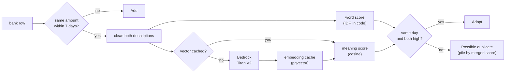

# Pair bank rows by a cleaned word score plus a Bedrock embedding score, and Adopt only when both are high

Technical Story: [adr017 negative consequence "Pairing counts words; it doesn't understand them"](adr017-external-transaction-sync-via-cdr-redbark.md)

## Context and Problem Statement

The bank sync and the history import reconcile each bank row against the household's Transactions ([adr017](adr017-external-transaction-sync-via-cdr-redbark.md), facet 2). Today the description plays a part in only two places, and only as a count of shared words (`sharedWords`, `src/domain/transactions/reconcile-synced.ts:22`):

- **Picking the partner.** When a bank row could pair with more than one Transaction, the pair that shares the most words wins, then the nearest day (`reconcile-synced.ts:195`, `:212`).
- **Picking the pile.** A Possible duplicate with 3 or more shared words shows under "Similar description", the rest under "Different description" (`SIMILAR_WORDS`, `import.display.ts:150`).

An **Adopt** ignores the description: the same day and the same amount to the cent are enough. Counting words fails three ways on real data:

- **Different merchants pair up.** "PAYPAL \*NETFLIX AUS" and "PAYPAL \*SPOTIFY\*P40603 AUS" both cost $22.99. On the same day they Adopt each other (seen in March, branch DB), and nothing asks the Member.
- **The same merchant looks different.** A typed "Netflix" shares 1 word with the bank's "NETFLIX.COM SYDNEY AUS", so a real copy lands in "Different description".
- **Noise counts.** "PAYPAL", "AUS" and card numbers count as shared words just like the merchant name.

How should Ledger score how alike two descriptions are, so that an Adopt never pairs two different purchases, and the partner and the pile reflect the merchant, not the noise?

## Decision Drivers

- **No silent wrong match.** An Adopt is never reviewed by a Member, so it must be the strictest test. A wrong review costs a click; a wrong Adopt rewrites a row unseen.
- **Same merchant, different wording.** A short typed name and the bank's long text for the same purchase must score as alike.
- **Noise doesn't count.** Payment-processor prefixes, country codes and long digit runs must not make two merchants look alike.
- **Bank data is never blocked.** A scoring outage must not stop a sync or an import. It can only make Ledger more careful.
- **Descriptions stay close.** Bank descriptions are personal data. Prefer a provider the app already trusts with personal data, in its region.
- **Small surface.** Pre-PMF, one developer. A bank row is only compared with the 1 to 3 Transactions of the same amount within 7 days, never searched against the whole history, so no search engine or vector index is needed.
- **A retry gives the same answer.** adr017 needs the reconcile to be deterministic, so a retried run makes the same pairs.

## Considered Options

1. **Meaning only.** Embed both descriptions and use cosine similarity.
2. **Words only.** A BM25-style score: shared words weighted by how rare each is across the household's descriptions.
3. **Both, on cleaned text.** Strip known noise, compute both scores, and need both high for an Adopt; merge them for the partner and the pile.
4. **Status quo.** Count shared words (`sharedWords`, 3 for "Similar").

## Decision Outcome

Chosen option: "3. Both, on cleaned text", because it is the only option where two different merchants that share noise and two wordings of one merchant both score right, and an Adopt still needs two independent signals to agree. See the diagram under option 3.

The decision in detail:

1. **Clean first.** Before either score, drop payment-processor prefixes (`PAYPAL *`, `SQ *`, …), country codes and long digit runs (the list is in item 8). Both scores and the embedding cache use the cleaned text.
2. **Word score.** A plain function in the transactions domain. Each shared word counts by its rarity across the household's descriptions (an IDF weight), so "NETFLIX" counts for a lot and "AUS" for little. No BM25 store.
3. **Meaning score.** Cosine similarity of two embeddings from **Amazon Titan Text Embeddings V2 on Bedrock** (`amazon.titan-embed-text-v2:0`, 1024 dimensions, normalised). It is a bare in-region model id: there is no inference profile for it. Bedrock already serves receipt extraction through Vercel OIDC in `ap-southeast-2` ([adr014](adr014-bedrock-via-vercel-oidc.md), `src/server/aws/bedrock.ts`), so this adds no vendor, key or contract. Only the cleaned description is sent; never the amount, date or account.
4. **Embed only what pairs.** A description is embedded only when its bank row has a same-amount Transaction within 7 days, not for every bank row. Each vector is cached in a transactions-domain table keyed by model and cleaned text (a pgvector column, no index), so a repeat merchant is embedded once, and a later model change only adds new keys.
5. **Three uses, one pair of scores.**
   - **Adopt:** the same day, the same amount to the cent, **and** both scores at or above their high thresholds.
   - **Possible duplicate:** the same amount within 7 days but not an Adopt. That now includes a same-day pair whose descriptions fall short.
   - **Partner and pile:** the merged score picks the partner (then the nearest day) and splits "Similar" from "Different".
6. **When the meaning score is unavailable** (Bedrock error after the AI SDK's 2 retries, or no AWS access): the step logs `embedding unavailable` and uses only cached vectors, counting batches of 32 saved earlier in the same run. A pair missing either vector never Adopts, so a same-day pair goes to review; the word score alone picks its partner and pile. Bank data still lands.
7. **No backfill.** Adopts made under the old rule stay. A crossed one only took a date and amount that were already equal; the Member fixes it by hand.
8. **Tuned on real rows.** A spike (branch `spike/adr029-description-scores`, `scripts/spike-description-scores.ts`) imported Dec 2025 to Aug 2026 into the branch DB with Adopts turned off, so every pair kept both descriptions. It labelled the 574 pairs the import flagged plus 3 fixed cases: 561 same purchase, 15 two purchases, 1 dropped as unclear. It picked by a rule fixed before scoring:
   - **Model:** Titan V2. Meaning-score AUC 1.000, against 0.9999 for Cohere Embed English v3. Within 0.02, so the cheaper Titan wins. The word score alone scored 0.999. Both models answered in `ap-southeast-2` through `@ai-sdk/amazon-bedrock`'s `embedMany`, with local AWS keys; the OIDC path is checked on the preview deploy.
   - **Thresholds:** `ADOPT_WORD_SCORE = 0.55`, `ADOPT_MEANING_SCORE = 0.70`, `SIMILAR_SCORE = 0.59`. Each Adopt bar is the larger of a floor (0.5 word, 0.7 meaning) and the highest two-purchase pair plus 0.05. The highest two-purchase pairs were 0.49 (word) and 0.40 (meaning), both a transfer noted "99 Bikes" against the 99 Bikes purchase. "Similar" is the merged-score cut with the best accuracy (575 of 576).
   - **Merge:** equal weights, `(word + meaning) / 2`; the word score alone when meaning is missing. Not tuned.
   - **Cleaning list:**
     - Processor prefixes `PAYPAL`, `SQ`, `SP`, `ZLR`, `IZ`, `LS`, `DBS`, `PIN`, `SMP`. Each is stripped only when it starts the text and a `*` follows, so "SPOTIFY" and "SP CAFE" stay whole.
     - Noise words `AUS`, `AU`, `QL`, `QLD`, `CARD`, `VALUE`, `DATE`. The last three come from the bank's ", Card xx6857, Value date: 03/07/2026" suffix.
     - Dates like `03/07/2026`.
     - Any word with 3 or more digits.
     - The bank's foreign-amount suffix, from `FRGN AMT` to the end ("FRGN AMT: 20.00  U. S. DOLLAR"). Added after the spike, once the first live import flagged Vercel pairs it should have adopted.
   - **Word weights:** document frequency over the distinct cleaned descriptions of every household Transaction plus the incoming batch, recomputed on each reconcile that has a pair. Nothing is stored.
   - **What it costs:** 10 of the 561 same-purchase pairs miss an Adopt and go to review. These are 8 Vercel charges whose bank text adds a foreign-amount suffix (cleaned: "FRGN AMT 20 00 U S DOLLAR"), a typed "Netflix" against "NETFLIX.COM SYDNEY AUS", and "Woolies" against "WOOLWORTHS SYDNEY". "Woolies" scores 0 on words, so it lands in "Different description". All 15 two-purchase pairs stay out of Adopt.
   - **Caveat:** most household rows on the branch DB were copies of bank text, so typed names were only the fixed cases.

This changes adr017 facet 2: its **Adopt** rule gains the description test, its **Possible duplicate** rule gains same-day pairs, and its pairing order uses the merged score instead of shared words. `CONTEXT.md` (Adopt, Possible duplicate) already carries the new wording, marked as this ADR.

### Positive Consequences

- Two same-priced subscriptions on one day can no longer Adopt each other unseen; they go to review.
- "Netflix" and "NETFLIX.COM SYDNEY AUS" land in "Similar description", so its fill button (Use bank's) answers them right.
- Noise stops counting: "PAYPAL" and "AUS" weigh little in the word score and are gone before the embedding.
- No new vendor or secret: the same Bedrock path, region and OIDC role as receipt extraction.
- A model change is a cache-key change, not a migration of every row.

### Negative Consequences

- **More reviews.** A real same-day copy with very different wording (a typed "Coffee" against "SQ \*BEAN THERE CAFE") now waits for a click instead of matching.
- **A network call inside the reconcile.** Embeddings are fetched before the reconcile's database transaction, so the transaction stays short, but a sync step now depends on Bedrock as well as RedBark.
- **An outage leaves reviews behind.** A pair flagged while Bedrock is down stays a review; a later sync refreshes it but never rescores it, so a Member answers it by hand.
- **New moving parts.** The pgvector extension, an embedding cache table, a cleaning list to keep up, and thresholds that need tuning on real data.
- **Determinism rests on the cache.** The same model returns the same vector for the same text, and the cache pins it, so a retry gives the same pairs. A model change can move a borderline pair to the other side of a threshold.
- **Descriptions leave the database.** They go to Bedrock in the app's own AWS account and region, under the same terms as receipt images today.
- **A held row can collect a second review.** Each account reconciles on its own, so a row held by a weak pair (an own-account transfer on its day) is flagged again by a bank row a day or more off when that pair is "Similar" and none of the row's pending reviews is. That is one more click; "Use bank's" releases the other review. A weaker bank row is still added, and so is any day-off row once a Similar review holds the row, since a second close copy is likely another purchase.

## Pros and Cons of the Options

### 1. Meaning only

- Good, because a short typed name and the bank's long text for one merchant score as alike.
- Good, because one score, one threshold.
- Bad, because the noise dominates short bank text: "PAYPAL \*NETFLIX AUS" and "PAYPAL \*SPOTIFY AUS" both read as "a PayPal subscription in Australia" and can score high. That is the cross-match this ADR exists to stop.
- Bad, because an outage leaves nothing to fall back on.

### 2. Words only

- Good, because rarity weighting fixes the noise: "NETFLIX" outweighs "PAYPAL" and "AUS".
- Good, because it's pure code: no network, no new table, deterministic.
- Bad, because it can't see that "Woolies" means "WOOLWORTHS", or that a typed "Netflix" means "NETFLIX.COM".
- Bad, because a rare shared token that isn't the merchant (a suburb, a shared processor code) can still pair two merchants.

### 3. Both, on cleaned text

| Correctness | Cost | Reliability | Surface |
| --- | --- | --- | --- |
| Adopt needs two independent signals to agree | One small embedding call per new cleaned description that has a partner | Bedrock outage → more reviews, never a blocked sync or a wrong Adopt | pgvector, one cache table, a cleaning list, two thresholds |
| Wording differences and noise both handled | Repeat merchants cost nothing (cache) | Deterministic through the cache | Reuses the Bedrock adapter and OIDC role |

### 4. Status quo

- Good, because it's already built and tested (`reconcile-synced.test.ts`).
- Bad, because it Adopts different merchants on one day, misplaces short typed names, and counts noise (see Context).

### Embedding provider (for option 3)

| Provider | Data path | New setup | Notes |
| --- | --- | --- | --- |
| **Bedrock: Amazon Titan Text Embeddings V2** (chosen) | Own AWS account, `ap-southeast-2` | None (adr014) | Cheap; made for short text retrieval. Spike AUC 1.000 |
| Bedrock: Cohere Embed | Own AWS account, `ap-southeast-2` | None (adr014) | Spike AUC 0.9999, so no gain to justify its input type |
| VoyageAI | Third party | New vendor, API key, contract | Strong models; only if both Bedrock models fall short |
| OpenAI embeddings | Third party | New vendor, API key, contract | No edge over Voyage here |
| A small model inside the app | Never leaves | Heavy deploy, slow cold starts, more memory on Vercel | Only if descriptions must never leave the app |

## Links

- Refines [adr017](adr017-external-transaction-sync-via-cdr-redbark.md) facet 2 (Adopt, Possible duplicate, pairing order)
- Uses [adr014](adr014-bedrock-via-vercel-oidc.md) (Bedrock via Vercel OIDC)
- Cache table owned per [adr022](adr022-cross-domain-data-through-the-owning-service.md) by the transactions domain
- Feature: [History import](../feature/history-import.md)
