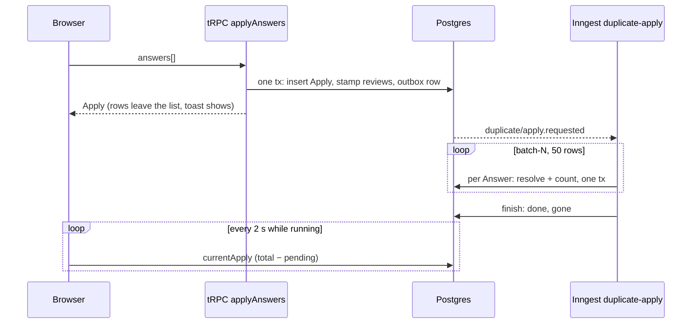

# Apply possible-duplicate Answers as a background job, stamped on the review row, with progress polled from Postgres

Technical Story: [Async duplicate apply with a progress toast](../../thoughts/designs/2026-11-04-async-duplicate-apply-progress-toast.md)

## Context and Problem Statement

A Member answers each Possible duplicate on the Import page (Keep mine, Use bank's or Both are real), then clicks Apply. Today the browser does the work:

- `possible-duplicate-list.tsx` loops over the Answers, one 200-Answer `resolveDuplicates` call after another, and keeps the tally in memory.
- Each Answer makes 1–4 DB writes (`keepMine`, `useBanks`, `bothReal` in `transactions.repository.ts`), so a few hundred Answers take long enough to notice.
- The page blocks until the loop ends. A reload or dropped connection kills the loop. The Answers that landed stay, but the tally is lost and nothing shows where it stopped.

Three facts shape the options:

- A review is already its own unit of work. Every resolve is guarded on `status = pending`, so running an Answer twice is harmless: the second run finds nothing to do.
- Answer order matters on a shared Transaction: "Use bank's" on one review adds the bank row of every other pending review on that Transaction, overriding a "Keep mine" not yet run.
- Rows vanish mid-run. "Use bank's" and "Both are real" delete the review row. "Use bank's" also deletes every other pending review on the same Transaction (`takeReviewsOn`), and the bank sync releases pending reviews the same way.
- The bank history import already runs as a background job: a `cdr_import` row, an outbox event, Inngest `cdr-import`, and a page that polls `latestImport` every 3 s.

How should Ledger run an Apply so the Member can leave the page, and can always see whether and where it stopped?

## Decision Drivers

- **Survives the browser.** A reload, a closed tab or a dropped connection must not lose the run or its progress.
- **Shows where it stopped.** After a failure, the Member can see which Answers didn't apply and send them again without re-picking.
- **Exact counts on retry.** A retried step must not count an Answer twice or apply it twice.
- **No new moving parts.** Prefer the outbox, Inngest and polling the codebase already runs.
- **Starts at once.** An Apply must not wait behind a long bank import.

## Considered Options

1. Browser loop in a shared client store
1. Background job; Answers stamped on the review row; progress polled from Postgres
1. Background job; Answers as JSON on the Apply row; progress polled
1. Background job; Answers in a separate `apply_answer` table; progress polled
1. Background job; progress pushed through Inngest Realtime

## Decision Outcome

Chosen option: "2. Background job; Answers stamped on the review row; progress polled from Postgres", because it is the only option that meets every driver: Postgres holds the whole state, the leftover rows show where a run stopped, and the review row's own `pending` guard makes a retry exact without new bookkeeping.

How it works (diagram under option 2):

- `possible_duplicate` gains `apply_id` (FK to a new `duplicate_apply` row, `on delete set null`) and `answer`.
- `start` makes one `outbox.commit` transaction. It fails any stuck running Apply, inserts the Apply, stamps the still-pending reviews that aren't in a running Apply, and emits `duplicate/apply.requested`. A partial unique index allows one `running` Apply; a clash throws `ConflictError`. One Apply takes up to 10,000 Answers, a cap set by Postgres's 65,534 bind-value limit on the stamping query.
- Inngest `duplicate-apply` (own concurrency key `"duplicate-apply"`, retries 3) loops `batch-N` steps of 50, ordered Keep mine → Both are real → Use bank's, so a "Use bank's" can never release a row the Member chose to keep. Each Answer and its `applied + 1` share one transaction; a unique-key clash clears the stamp and adds 1 to `taken`. A `finish` step sets `gone = total − applied − taken`; `onFailure` marks the Apply `failed`.
- A watcher in the dashboard layout polls `currentApply` every 2 s while one runs and drives one sonner toast. Progress is `total − pending`, where `pending` counts pending rows still stamped.

### Positive Consequences

- A reload, closed tab or dropped connection loses nothing. The toast comes back from `currentApply`, and the Answers keep applying server-side.
- A failed Apply leaves its leftover rows pending, with their `answer` and a "Didn't apply" note. The Member re-applies from the list, so there is one Apply path, not a separate retry.
- `applied` and `taken` are a ledger, not a guide: each count is bumped in the same transaction as its Answer, and a retried batch skips rows already out of `pending`.
- Rows in a running Apply are hidden from the list and counts, so the same review can't be sent twice.
- It reuses the outbox (adr002), Inngest and the `latestImport` polling pattern. No push transport to run or secure.

### Negative Consequences

- New frozen wire strings: event `duplicate/apply.requested`, function ids `duplicate-apply` and `duplicate-apply-failure`, concurrency key `"duplicate-apply"`. `registry-golden.test.ts` pins them; renaming one later needs an ADR note.
- `DrizzleTransactionsRepository` takes an `outbox: OutboxWriteDoor` dep, as `DrizzleCdrRepository` does.
- `gone` is derived at finish, not counted. A row that vanished mid-run (deleted by another Answer, released by a sync, or cascaded with its Transaction) shows only as the gap.
- Its counts follow a different rule from `cdr_import`, whose counts are "a guide, not a ledger". A reader must not copy one rule onto the other.
- A 15-minute stuck rule: a `running` Apply with no progress for that long (`updatedAt`, moved by every count) reads as inactive, and the next `start` fails it. It reads progress, not age, so a big Apply that is still working never trips it. A worker that wakes later finds its rows unstamped or its Apply `failed` and does nothing.
- One Apply at a time. A Member who answers more rows during a run waits for it to finish before applying them.
- Progress moves in 2 s polls, not a smooth stream.
- A second service in the transactions domain (`DuplicateApplyService`), since the worker needs different deps from `TransactionsService`.

## Pros and Cons of the Options

### 1. Browser loop in a shared client store

The loop moves out of the page into a module-level store, so navigation doesn't stop it.

- Good, because it is the smallest change: no schema, no worker.
- Bad, because a reload, closed tab or dropped connection still kills the run and its tally, which is the main complaint.
- Bad, because progress lives in one tab's memory; another tab can't see it.

### 2. Background job; Answers stamped on the review row; progress polled from Postgres

| Pros | Cons |
| --- | --- |
| Postgres holds the whole state, so a reload rebuilds it | A schema change on `possible_duplicate` plus a new table |
| Leftover stamped rows are the "where it stopped" list | `gone` derived, not counted |
| The existing `pending` guard makes retries exact | New frozen Inngest ids |
| Hidden rows stop a double send | Progress moves in 2 s steps |

### 3. Background job; Answers as JSON on the Apply row; progress polled

The Apply row holds the Answers array and a cursor (a recovery point), and the review table stays untouched.

- Good, because the review table needs no new columns.
- Bad, because nothing stops a review appearing in two Applies at once.
- Bad, because hiding or flagging rows in the list means reading every active Apply's JSON.
- Bad, because a cursor counts positions, not outcomes: a row deleted by another Answer still needs the same derived `gone`.

### 4. Background job; Answers in a separate `apply_answer` table; progress polled

One row per Answer: `applyId`, `reviewId`, `answer`, `outcome`.

- Good, because every Answer keeps its own outcome, even after its review row is deleted.
- Bad, because it adds a table whose job the stamped review row already does: pending stamped rows are the outstanding Answers.
- Bad, because the list must join it to hide or flag rows.

### 5. Background job; progress pushed through Inngest Realtime

The worker publishes progress on a channel; the browser subscribes with `useRealtime` (built into `inngest` v4).

- Good, because the bar moves as each Answer lands, not on a poll.
- Bad, because Realtime is a developer preview with at-most-once delivery and no documented replay on reconnect.
- Bad, because a reload still needs a Postgres row to rebuild from, so it adds a transport without removing the row.
- Bad, because it needs a token route and channel auth the app doesn't run today.

## Links

- Design: [Async duplicate apply with a progress toast](../../thoughts/designs/2026-11-04-async-duplicate-apply-progress-toast.md)
- Builds on [adr002](adr002-canonical-postgres-store-transactional-outbox.md) (outbox write door)
- Related to [adr017](adr017-external-transaction-sync-via-cdr-redbark.md) (`cdr-import` precedent, Possible duplicates)
- Related to [adr029](adr029-pair-bank-rows-by-word-and-meaning-scores.md) (how reviews are flagged)
- Vendor docs: [Inngest Realtime](https://www.inngest.com/docs/realtime)
