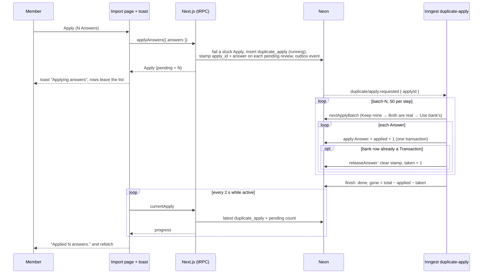
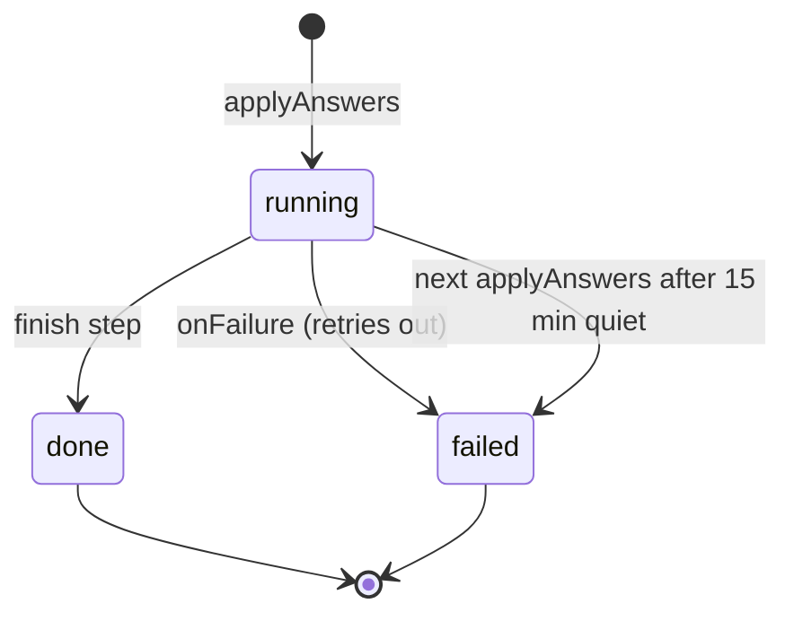

# Duplicate Apply

> Answer your Possible duplicates, click Apply, and keep using Ledger while a toast counts the Answers in.

## User value

A Bank import can leave hundreds of Possible duplicates to answer. Apply sends every Answer at once. Ledger saves them all right away, then works through them in the background. A toast with a progress bar follows you from page to page. If the work stops partway, the toast says where, and the rows it missed keep your Answer.

**Who it's for**: a Member clearing the To review list on `/transactions/import`, often hundreds of rows after a Bank import.
**Problem it solves**: Apply used to run in the browser. The page stayed locked until it finished, and a reload or a lost connection stopped it with no record of where.
**Outcome they get**: a toast shows "Applying answers" with a progress bar as soon as they click Apply. They can go to other pages while it runs. At the end it says "Applied N answers." If it stops, it says "Stopped at x of y" and links back to the list, where each missed row shows its Answer, marked "Didn't apply".
**Out of scope**:
- Canceling a running Apply.
- A Retry button in the toast. The Member applies again from the list.
- A history of past Applies. Only the latest one shows.
- Tying an Apply to one Member. The Household owns it, so every Member sees its toast.
- Labeling a row that came back blank because its bank row is already a Transaction. Only the finish toast mentions it.
- Two Applies at once. The server refuses a second.

## Design

**Lives in**:
- `src/app/(dashboard)/transactions/import/_components/possible-duplicate-list.tsx` calls `transaction.applyAnswers`, puts the started Apply in the `currentApply` cache, and refetches the list.
- `src/app/(dashboard)/transactions/import/_components/possible-duplicate-piles.tsx` holds the Member's picks over each row's saved Answer, shows the "Didn't apply" badge, and locks Apply while an Apply runs.
- `src/components/apply-progress.tsx` holds `ApplyProgress`. It sits in `src/app/(dashboard)/layout.tsx` and polls `currentApply` every 2 s while an Apply runs. `ApplyToasts` turns each poll into one sonner toast.
- `src/components/apply-toast.tsx` draws the toast: progress bar, finish copy, Review link, Close.
- `src/components/apply-progress.display.ts` holds the toast copy and picks the outcome (success, warning, error).
- `src/server/transactions/transactions.trpc.controller.ts` declares `applyAnswers` (mutation) and `currentApply` (query).
- `src/server/transactions/duplicate-apply.service.ts` holds `DuplicateApplyService`: `start`, `applyBatch`, `finish`, `fail`, `current`. It also holds the batch size (50) and the 15-minute stuck rule.
- `src/server/transactions/transactions.inngest.controller.ts` declares the `duplicate-apply` function and its `onFailure`.
- `src/server/transactions/transactions.repository.ts` has the queries `startApply`, `nextApplyBatch`, `applyAnswer`, `releaseAnswer`, `finishApply`, `failApply` and `latestApply`. `listPendingDuplicates` and `countPendingDuplicates` hide the rows of a running Apply.
- `src/server/transactions/transactions.schema.ts` holds the `duplicate_apply` table and the `possible_duplicate.apply_id` and `answer` columns (migration `0029`).
- `src/domain/transactions/transaction.dto.ts` holds `applyAnswersDto`: 1 to 10,000 Answers (`APPLY_ANSWERS_MAX`), each review once.

**Choice made**: a server job. `applyAnswers` writes these in one transaction: the `duplicate_apply` row, each Answer stamped on its `possible_duplicate` row (`apply_id`, `answer`), and an outbox event. The Inngest `duplicate-apply` worker then applies Answers 50 per step, and every Member's tab polls the `duplicate_apply` row (adr032).
**Rejected alternatives**:
- A browser loop in a global store. It dies on reload.
- Inngest Realtime push. It's a developer preview, delivers at most once, and still needs the row.
- Answers as JSON on the Apply row, or in their own table. Stamping the review row keeps a missed Answer visible on the list.
- One step for the whole Apply (timeout risk) or one step per Answer (overhead, and Inngest's 1,000-step cap).

**Trade-offs**:
- **Order matters.** Each batch runs Keep mine, then Both are real, then Use bank's, by id within each. A Use bank's turns every other pending review on its Transaction into its own Transaction, so a Keep mine on that Transaction must land first.
- **Exact counts.** Each Answer and its `applied + 1` share one transaction. A retried batch skips rows that are no longer pending, so it never counts one twice.
- **Stuck by quiet, not by age.** Every applied or taken Answer moves `updatedAt`. A running Apply with no progress for 15 minutes reads as not active. The next `start` marks it `failed` ("No progress; failed by the next apply."). A big Apply that keeps moving never trips it.
- **Its own concurrency slot** (`"duplicate-apply"`), not `"cdr-sync"`. Sharing that slot would leave the toast stuck at 0 behind a long Bank import. Every write checks `status = pending`, so an Apply never undoes a sync. A Use bank's and a sync on the same Transaction lock its rows in opposite order and can deadlock, and Postgres aborts one side. An Apply or a Bank import retries its step. A daily sync doesn't retry: it marks the account with an error, and the next daily sync, or the Member's re-run, is the retry.
- **A late worker can't touch a newer Apply's row.** Each write matches the review's `apply_id` as well as `pending`.
- **A late worker can't revive a Stopped Apply.** Each Answer first locks the Apply row and checks it is still live. A finish that comes too late marks the Apply `failed` ("No progress; its worker finished too late.") and logs it.
- **The finish toast shows only in a tab that saw the Apply run.** A page load never replays an old result. After a reload, the "Didn't apply" rows are the record.
- No job prunes `duplicate_apply` rows.

### Operations

**Health signals**:
- Inngest dashboard: `duplicate-apply` runs and their `batch-N` / `finish` steps.
- The latest `duplicate_apply` row: `status`, `total`, `applied`, `taken`, `gone`, `error`.
- Log line `duplicate apply failed` (error level), with `applyId` and the message.
- Log line `duplicate apply finished late` (error level), with `applyId` and `stopped` (whether this finish was the one that failed it).
- `TracingMiddleware.onRunError` sends each thrown run error to PostHog error tracking.

**Alerts**: none. One household uses the app before launch, and the Member sees a Stopped Apply in the app. Add an alert if Stopped Applies start to happen.

**Failure modes & fallback**:

| Case | What happens | What the Member sees |
|---|---|---|
| Submit fails (offline, 500) | One transaction, so nothing is saved | Error toast; picks stay |
| Submit while an Apply runs | `ConflictError` | "An apply is already running." |
| Transient DB error in a batch | Inngest retries the step (3 retries) | The bar pauses, then moves on |
| Retries run out | `onFailure` → `failed` plus `error` | "Stopped at x of y. N answers didn't apply." with Review; missed rows keep their Answer, marked "Didn't apply" |
| Event never delivered | `outbox-sweep` re-sends it at the top of the hour. Within 15 minutes, the Apply runs as normal. Later, it already reads as Stopped: the worker applies nothing, fails it, and logs `duplicate apply finished late`. The next Apply also fails a stuck one | Same as retries running out |
| Use bank's whose bank row is already another Transaction | Unique-key clash → `releaseAnswer` clears the Answer, `taken + 1` | "N still need an answer: the bank's row is already in your transactions." The row comes back blank |
| Review gone before its turn (answered in another tab, settled by a sync, its Transaction deleted, or released by another Use bank's) | Counted `gone` at finish | "N no longer needed an answer." |

**Flags / env vars**: none.

## Flow

**Triggers**:
- UI: Apply on the To review list (`/transactions/import`) → `transaction.applyAnswers`.
- Event: `duplicate/apply.requested { applyId }`, sent through the outbox in the same transaction as the stamps → Inngest `duplicate-apply`.
- Poll: `ApplyProgress` in the dashboard layout → `transaction.currentApply`, every 2 s while the latest Apply is active.

**Data path**: `applyAnswers` saves one `duplicate_apply` row and stamps each Answer on its review row. The rows leave the list at once. The worker applies the stamped Answers 50 at a time and adds each one to `applied` (or `taken`). The toast reads `total − pending`, where `pending` counts the Apply's rows that are still pending. When the Apply ends, the tab refetches Transactions and the budget.

**State transitions** (`duplicate_apply.status`):

A review row in an Apply is in one of three states:
- **In a running Apply**: pending, and `apply_id` points at an active Apply. Hidden from the list and the counts.
- **Didn't apply**: pending, and `apply_id` points at a `failed` or stuck Apply. Listed with its `answer` filled in and a "Didn't apply" badge. The next Apply sends that Answer again unless the Member changes it.
- **Applied**: the Answer ran, so the review row is gone or no longer pending.

**Edge cases**:
- **Close the toast mid-Apply.** It stays closed for that Apply. The finish toast still shows.
- **Reload mid-Apply.** The toast comes back on the next poll.
- **Another tab starts the next Apply** before this tab polls the end. This tab drops the old toast, refetches, and shows the new one.
- **Tab closed mid-Apply.** The job keeps going. On return, the list shows the result.
- **Clear on a "Didn't apply" row** blanks its saved Answer for this send.
- **Error toast**, and a warning with taken rows, stays until closed and links to Review. A success toast, or a warning with only gone rows, closes after 5 s.

**Side effects**: the same writes as each Answer (see [History import](history-import.md#flow): Keep mine drops the bank row, Use bank's updates your row and frees its other reviews, Both are real adds the bank row). Inserts one `outbox` row per Apply. Invalidates the `transaction.*` and `expense.consumption` queries when an Apply ends.

## Links

- ADRs: [adr032](../adr/adr032-apply-answers-as-a-background-job-stamped-on-the-review-row.md), [adr002](../adr/adr002-canonical-postgres-store-transactional-outbox.md), [adr004](../adr/adr004-domain-oriented-3-tier-server-architecture.md), [adr017](../adr/adr017-external-transaction-sync-via-cdr-redbark.md), [adr029](../adr/adr029-pair-bank-rows-by-word-and-meaning-scores.md)
- Design: [Async duplicate apply with a progress toast](../../thoughts/designs/2026-11-04-async-duplicate-apply-progress-toast.md)
- Related plans: [Async duplicate apply plan](../../thoughts/plans/2026-11-04-async-duplicate-apply-progress-toast.md)
- Related features: [History import](history-import.md) (the To review list lives on its page)
- GitHub issues: none
- Shipping PRs: none yet

---
*Generated from interview on 2026-11-05. To regenerate, run `/document-feature async-duplicate-apply`.*
