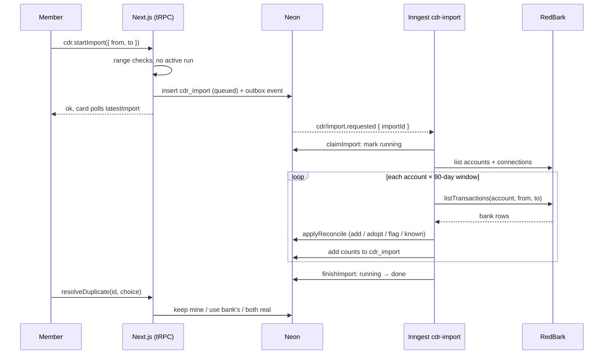
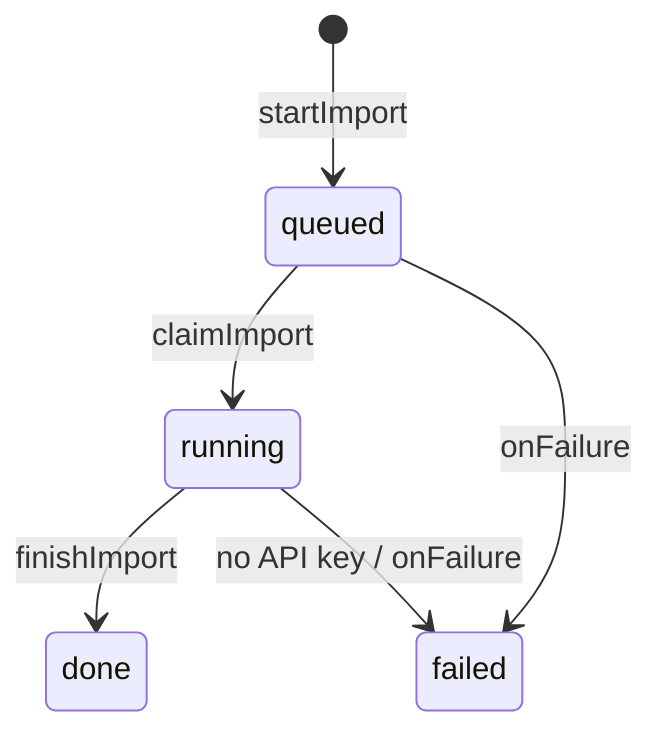

# History import

> Pick a date range, and Ledger brings in your older bank history, up to 7 years back, without making copies of rows you already have.

## User value

The daily bank sync only reaches back about 14 days. Anything older stays missing unless someone types it in. This page fills the gap in one run, and you can run it again safely.

**Who it's for**: a household member who linked a bank through RedBark and wants older history in Ledger.
**Problem it solves**: older bank rows are missing, and many of them were already typed in by hand or made from receipts, so a plain copy would double them.
**Outcome they get**: Ledger adds the missing bank rows and joins each exact match to the row you already have. Close matches wait on the page for your answer. Nothing is deleted.
**Out of scope**: picking which accounts to import (the run includes every live, syncable account); stopping a run partway; more than 7 years back; ranges ending after today; alerts or PostHog events for imports (see Operations).

## Design

**Lives in**:
- `src/app/(dashboard)/transactions/import/page.tsx` — the route; prefetches `latestImport` and `possibleDuplicates`.
- `src/app/(dashboard)/transactions/import/_components/import-view.tsx` — layout; polls `latestImport` every 3 s while a run is active and refreshes transaction queries when it ends.
- `src/app/(dashboard)/transactions/import/_components/import-form.tsx` — the From / To form; locked while a run is active.
- `src/app/(dashboard)/transactions/import/_components/import-status.tsx` — the Latest import card: status, range, counts, failure reason.
- `src/app/(dashboard)/transactions/import/_components/possible-duplicate-list.tsx` + `possible-duplicate-card.tsx` — the To review list: your row beside the bank's, with the gaps marked, and three answers.
- `src/app/(dashboard)/transactions/import/_components/import.display.ts` — status labels, counts, the range line, the gap chips.
- `src/app/(dashboard)/transactions/_components/transactions-view.tsx` — the "Import from bank" header button and its pending-review badge.
- `src/domain/cdr/import-range.ts` — `importWindows` (90-day windows), `IMPORT_MAX_YEARS`, `importEarliestDay`, `importRangeError` (the form and `startImport` both call it).
- `src/server/cdr/cdr.service.ts` — `startImport` (range checks, one active run) and `latestImport` (adds `active`).
- `src/server/cdr/cdr-sync.service.ts` — `claimImport`, `planImport`, `importChunk`, `finishImport`, `failImport`.
- `src/server/cdr/cdr.inngest.controller.ts` — the `cdr-import` function and its `onFailure`.
- `src/server/cdr/cdr.schema.ts` — the `cdr_import` table (migration `0024`).
- `src/server/transactions/transactions.repository.ts` — `applyReconcile` (shared with `cdr-sync`) and the three resolve writes.
- `src/domain/transactions/reconcile-synced.ts` — `planReconcile`: known, adopt, flag or add, per bank row.

**Choice made**: a background Inngest job split into one step per account per 90-day window. Each step reconciles its rows the same way the daily sync does. Counts add up on the `cdr_import` row, and the page polls that row.
**Rejected alternatives**: fetching inside the request (7 years won't fit in a page load, and RedBark caps one read at 5,000 rows); one big step (a retry would redo the whole import).
**Trade-offs**:
- `cdr-import` and `cdr-sync` share one concurrency slot (`"cdr-sync"`). The slot limits steps, not whole runs, so a daily sync can slip in between import steps. That's safe: two reconciles never run at once, and each one only adds what's missing.
- `flagged` is the change in pending reviews, not the number made. Joining a bank row to your row can close a review an earlier step opened, so a run's total can go below 0. The page shows it as 0 at the lowest.
- A queued or running row older than 24 hours counts as not active, so a run that died without reaching `onFailure` can't block the form forever.
- The form and `startImport` share one range check, `importRangeError`, so they refuse the same ranges with the same words.

### Operations

**Health signals**: the Latest import card (status, counts, reason), the `cdr_import` row, and these log lines: `cdr import already claimed`, `cdr import skipped an account`, plus the RedBark errors from the shared sync code.
**Alerts**: *None yet. A failed run only shows on the page and in the logs. There's a `TODO(observability)` in `import-form.tsx`.*
**Failure modes & fallback**:
- `REDBARK_API_KEY` unset → the row reads Failed: "Bank sync isn't set up".
- RedBark 429 or 5xx → the step retries (3 retries) and honours `Retry-After` up to 1 hour. Asked to wait longer, it fails instead.
- Out of retries, or a non-retryable error → `onFailure` (`cdr-import-failure`) saves the reason. The card shows Failed with that reason, plus any counts so far.
- More than 997 chunks → fails with "This import is too big for one run. Try a shorter range."
- Run lost (cancelled in Inngest, or `failImport` hit a DB blip) → the card reads "Didn't finish" after 24 hours, and the form opens again.
- An account RedBark can't sync right now → the job skips and logs it, then imports the rest.

**Flags / env vars**: `REDBARK_API_KEY` (optional; see `docs/README.md`).

## Flow

**Triggers**:
- UI: the Import button on `/transactions/import` → `cdr.startImport`.
- Event: `cdr/import.requested` (sent through the outbox in the same transaction as the new `cdr_import` row) → Inngest `cdr-import`.
- UI: Keep mine / Use bank's / Both are real on a review card → `transaction.resolveDuplicate`.

**Data path**: `startImport` saves the picked range as a `cdr_import` row plus an outbox event. The job splits the range into account × 90-day chunks, reads each from RedBark, and reconciles the rows into `transaction` and `possible_duplicate`. Each chunk adds its counts to the row, which the page polls.

**State transitions** (`cdr_import.status`):

"Didn't finish" is computed at read time, not stored: a queued or running row older than 24 hours.

**What each bank row becomes** (`planReconcile`):
- **Already here** (`known`): the bank id is already in Ledger or waiting in a review, or a member already chose Keep mine on it. Ledger refreshes the row or review instead of doubling it.
- **Matched to yours** (`adopted`): same household day and same amount as a row you made. Your row takes the bank's id, date and amount, but keeps your description and edits. If that row was waiting in a review, the review closes and Ledger adds its bank row.
- **To review** (`flagged`): within 7 days and 5% of a row you made. A `possible_duplicate` waits on the page.
- **Added**: no match. Added as a new bank row.

**Review answers**:
- **Keep mine**: drops the bank's copy.
- **Use bank's**: your row takes the bank's date and amount.
- **Both are real**: adds the bank's row too.

After an answer, the card leaves, a toast confirms it, and focus moves to the next card, or to the To review heading when none are left.

**Edge cases**:
- Ranges that run past 7 years or after today, or a From after the To → stopped in the form, and again by the server with the same words.
- Starting while a run is active → the form locks and says why; the server returns a `CONFLICT` "An import is already running."
- The same review answered in another tab → the toast shows the error, and a refetch drops the old card.
- A repeat event delivery → `claimImport` finds the row past queued and runs nothing.

**Side effects**: inserts into `transaction` and `possible_duplicate`; updates your rows on adopt and Use bank's. Never moves the daily sync's cursor and never writes a balance anchor. Never deletes a transaction.

## Links

- ADRs: [adr017 — external transaction sync via CDR (RedBark)](../adr/adr017-external-transaction-sync-via-cdr-redbark.md), [adr022 — cross-domain data through the owning service](../adr/adr022-cross-domain-data-through-the-owning-service.md)
- Design: [Expense linking, receipts and cash flow](../../thoughts/designs/2026-08-16-expense-linking-receipts-cashflow.md) (build stage 7)
- Related plans: [Stage 7: CDR via RedBark](../../thoughts/plans/2026-09-15-expense-linking-stage-7-cdr-redbark.md) (Phases 7–8)
- GitHub issues: none
- Shipping commits: `e7c5107` (import page and job), `a9a8cd6` (net released reviews out of `flagged`)

---
*Generated from interview on 2026-10-28. To regenerate, run `/document-feature history-import`.*
