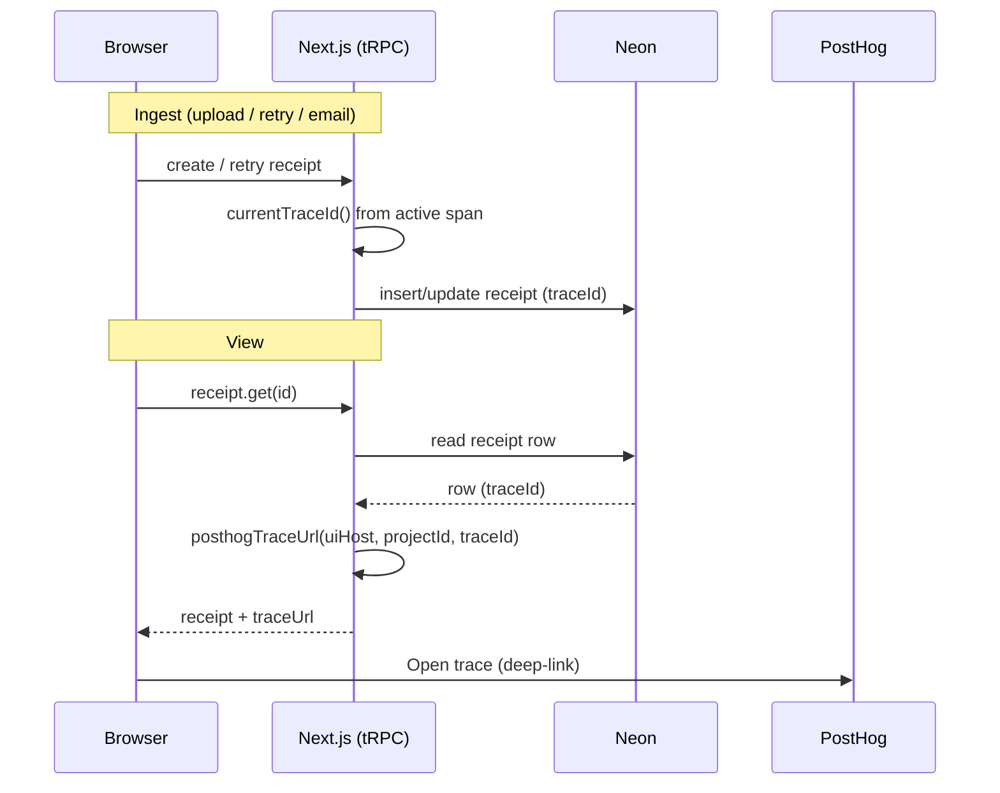
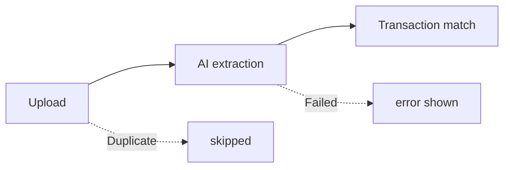

# Receipt trace diagnostics

> When a receipt is stuck or wrong, this shows you its processing trace and a one-click link to open that trace in PostHog.

## User value

**Who it's for**: whoever runs and debugs the app — right now the operator, not the everyday member.
**Problem it solves**: a receipt fails or looks off, and you need its exact PostHog trace to see why. Without a stored id you can't find the right run.
**Outcome they get**: every receipt row keeps the trace id of the run that made it. The receipt's "Developer details" panel shows that id, a Copy button, an "Open trace" link into PostHog, and a Timeline / Raw / Metadata view of what happened.
**Out of scope**: rendering the source receipt image/PDF/HTML (separate Receipt Viewer feature, adr019). Passing the trace id onward to Bedrock or Resend (outbound `fetch` carries no `traceparent`).

## Design

**Lives in**:
- `src/server/observability/current-trace-id.ts` — `currentTraceId()` reads the active OTel span's trace id; null when no span records.
- `src/lib/posthog-trace-url.ts` — pure `posthogTraceUrl()` builds the PostHog tracing deep-link; null without a project id or trace id.
- `src/domain/receipts/receipt-pipeline.ts` — pure `receiptPipeline()` maps a receipt to Upload → AI extraction → Transaction match timeline stages.
- `src/server/receipts/receipts.schema.ts` — nullable `traceId` text column (migration `0011`).
- `src/server/api/routers/receipts.ts` — `create` + `retry` stamp `currentTraceId()`; `get` builds `traceUrl`.
- `src/server/email/email.service.ts` — email ingest stamps the trace id through `createPendingReceipts`.
- `src/app/_components/receipts/more-details.tsx` — the `MoreDetails` diagnostics panel (trace header + tabs).
- `src/app/_components/receipts/receipt-detail.tsx` — renders `<MoreDetails>`.
- `src/env.ts` — `POSTHOG_UI_HOST` + `POSTHOG_PROJECT_ID`.

**Choice made**: capture the trace id at ingest and store it on the row, then build the PostHog link server-side from env + that id.
**Rejected alternatives**: build the link in the browser — rejected, it needs a `NEXT_PUBLIC_` project id and leaks config client-side; env stays server-only. Recompute the id on read — impossible, the active span only exists during the ingest request.
**Trade-offs**: `traceId` is nullable — null on keyless local runs (OTel unregistered) and on rows created before migration `0011`. `retry` overwrites the id with the new run's, dropping the prior run's trace id. The column has no index — the code reads it by receipt id, never queries by trace id.

> [!NOTE] This feature builds on three observability ADRs owned elsewhere: adr015 (PostHog-over-OTel) and adr016 (trace context in outbox) are still **Proposed**; adr018 (client-originated traceparent) is **Accepted**. Their status transitions belong to the observability stack, not here.

### Operations

**Health signals**: new receipt rows carry a non-null `traceId` when `POSTHOG_KEY` is set; the "Open trace" link resolves to the run in PostHog.
**Alerts**: none specific to this feature — it rides the observability stack's capture and flush.
**Failure modes & fallback**:
- No recording span (keyless local, or `POSTHOG_KEY` unset) → `traceId` null → header shows `—`, no Copy, no Open-trace link.
- `POSTHOG_PROJECT_ID` unset → `traceUrl` null → id + Copy still show, Open-trace link hidden.
- Missing/invalid timestamps in the timeline → that stage renders `—`.

**Flags / env vars**:
- `POSTHOG_KEY` — gates whether a span records at all, so it gates whether `traceId` is non-null.
- `POSTHOG_UI_HOST` — PostHog UI host, default `https://us.posthog.com` (distinct from the ingest `POSTHOG_HOST`).
- `POSTHOG_PROJECT_ID` — optional; without it the Open-trace link is absent.

## Flow

**Triggers** (all entry points):
- Ingest — receipt upload (`receipt.create`), retry (`receipt.retry`), inbound email (`email.service.ingest`): each captures `currentTraceId()` and stamps the row.
- Read — the receipt detail view renders `<MoreDetails>`, which reads `traceId` + `traceUrl` off the `receipt.get` result.

**Data path**: browser `traceparent` (adr018) → server span → `currentTraceId()` at ingest → `receipts.traceId` → `receipt.get` builds `traceUrl` from `POSTHOG_UI_HOST` + `POSTHOG_PROJECT_ID` → `MoreDetails` renders trace header + Timeline / Raw / Metadata.

**State transitions**: the timeline derives stages from the receipt's status — Pending (AI extraction active), Processed (extraction done; match ok or unmatched), Failed (carries `error`), Duplicate (short-circuited on content hash).

**Edge cases**: null trace id → `—` and no links; no project id → no Open-trace link; invalid stage timestamp → `—`.
**Side effects**: none beyond the row write at ingest. Reads are pure; the code builds the deep-link but never calls it.

## Links

- ADRs: [adr015](../adr/adr015-posthog-over-opentelemetry-via-vercel-otel.md), [adr016](../adr/adr016-trace-context-in-outbox-payload.md), [adr018](../adr/adr018-client-originated-traceparent.md)
- Related plans: [Receipt trace diagnostics](../../thoughts/plans/2026-09-23-receipt-trace-diagnostics.md)
- Shipping PRs: [#20](https://github.com/samjmarshall/personal-finance/pull/20)

---
*Generated from interview on 2026-09-23. To regenerate, run `/document-feature receipt-trace-diagnostics`.*
